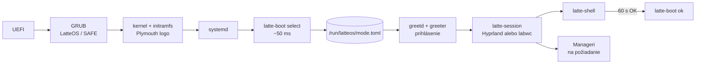
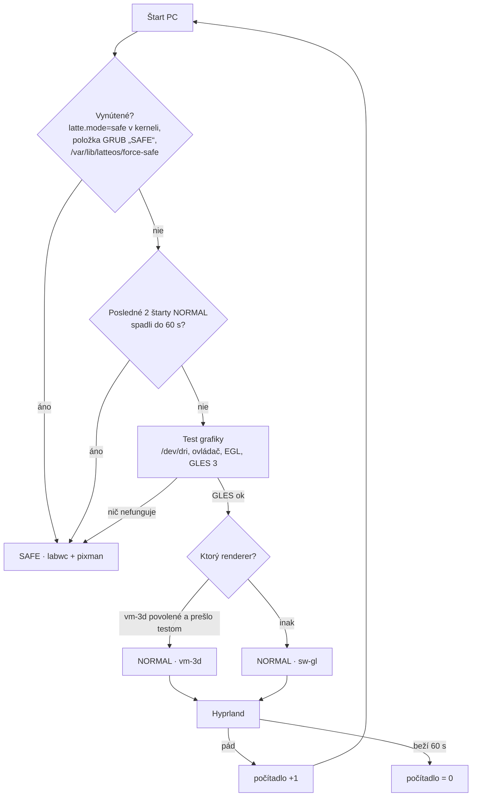

# LatteOS GOO — roadmapa (nový štart)

23. 9. 2026 · @Arkay · návrh v0.1

> **Zmena smeru 5. 10. 2026:** „gamerdistro“ sa stáva **LatteOS GOO**, jedinou edíciou. **LatteOS Classic sa ruší** —
> body roadmapy, ktoré sa týkajú iba klasickej plochy (lišta Noctalie, klasický spúšťač a panely), sa ďalej
> nerozvíjajú; ich funkcie preberá Goo. Prioritou je **engine Goo** (`session/goo`): poradie práce je v
> [LATTEOS-GOO.md](LATTEOS-GOO.md) a otvorené úlohy enginu nižšie v F3·G. Na systém sa nasadzuje **iba engine Goo**
> (6. 10.); verejné vydania nesú verziu a značku (prvé: **0.3.0 „Jihlavanka“**, iba GOO) — zverejňuje sa na pokyn.

Podklad: [technologický radar](inspo/LatteOS%20–%20technologický%20radar%202026.md),
prebraté zdroje v [resources/](resources/patches/README.md) (`fetch.sh`; pôvodný MANIFEST je v `old/resources/MANIFEST.md`). Priečinok `old/` sa už **nemení**, slúži len na čítanie.

## Rámec

| | Teraz (fázy F0–F8) | Neskôr |
|---|---|---|
| Systém | **Fedora Server 44**, klasický (dnf) | Fedora Atomic (bootc / rpm-ostree), štýl Bazzite, **až keď bude všetko hotové** |
| Stroj | **VirtualBox VM** `latteOSdev`: VMSVGA, 128 MB VRAM, 3D zapnuté, 4 vCPU, 11 GB RAM | reálny PC s 3D grafikou **AMD aj NVIDIA** |
| Grafika | **softvérová** (llvmpipe / pixman), VMSVGA 3D len ako doplnková možnosť | plná HW akcelerácia, Vulkan |

**Pravidlo pre všetko, čo vznikne teraz:** musí to bežať vo VM bez GPU. HW akcelerácia môže
iba pridať efekty, nikdy nesmie byť podmienkou fungovania.

## Odpoveď: pobeží stack bez akcelerácie?

Stav hosťa (overené na `latteOSdev`): adaptér `VMware SVGA II [15ad:0405]`, ovládač `vmwgfx`,
schopnosti `3D, dx, SM_5`. Kernel pritom hlási *„vmwgfx seems to be running on an unsupported
hypervisor. This configuration is likely broken.“* 3D cesta VirtualBoxu je preto menej spoľahlivá
ako vo VMware a nesmieme na nej stavať.

Vo VM prichádzajú do úvahy tri grafické cesty:

- **A · sw-gl:** GL cez llvmpipe na CPU. 3D je vypnuté alebo sa ignoruje (`MESA_LOADER_DRIVER_OVERRIDE=kms_swrast`, pozri F0).
- **B · vm-3d:** Mesa ovládač `svga` nad VMSVGA 3D.
- **C · pixman:** čisté CPU kreslenie, žiadne GL.

| Komponent | A · sw-gl | B · vm-3d | C · pixman | Poznámka |
|---|---|---|---|---|
| **Hyprland 0.56** | ✅ overené | ⚠️ overené: patch + render voľby, artefakty | ❌ | Vyžaduje GLES 3 cez EGL/GBM a pixman renderer nemá. llvmpipe GLES 3.2 poskytuje. Pod B bez patchu padajú GPU klienti (čierna plocha). |
| labwc (wlroots) | ✅ overené | ❌ overené bez patchu | ✅ overené `WLR_RENDERER=pixman` | Jediný kompozitor zo zoznamu, ktorý beží **úplne bez GL**, preto je základom SAFE. |
| Quickshell / DMS / Caelestia | ✅ pomalšie | ⚠️ | ⚠️ len `QT_QUICK_BACKEND=software` | `ShaderEffect` (materiály tém) na llvmpipe beží, na Qt software backende nie. |
| xdph, hyprlock, matugen, portály | ✅ | ✅ | ✅ | nenáročné |
| Mission Center, cosmic-files | ✅ | ✅ | ✅ | GTK4/iced majú softvérovú cestu |
| Ollama | ✅ CPU | — | — | vo VM len malý model 3–4B; Qwen3-14B-sk (Q4 ~9 GB) sa nezmestí popri desktope |
| Steam, umu, Proton | ⚠️ launcher áno, hry prakticky nie | ⚠️ | ❌ | DXVK/vkd3d potrebujú Vulkan; lavapipe je len na smoke test |
| gamescope | ❌ | ❌ | ❌ | potrebuje skutočný Vulkan + DRM → **fáza HW** |
| Valve Lepton | ❌ | ❌ | ❌ | mountuje Mesa/zink z hostiteľa, cieľ je Steam Frame → **fáza HW** |

✅ = funguje, ⚠️ = s obmedzením, ❌ = nefunguje. Stĺpce „očakávané“ vychádzajú z dokumentácie a
hlásení používateľov. **Prvá úloha F1 je overiť celú tabuľku meraním na `latteOSdev`.**

**Záver:** Hyprland aj navrhované nástroje môžu bežať bez akcelerácie (cesta A). Na VMSVGA 3D
(cesta B) pobežia iba s patchom `vmwgfx-dmabuf`. Predvolená cesta vo VM bude A. Cestu B zapne
selektor iba vtedy, keď prejde test. SAFE režim stojí na ceste C.

## Režimy: NORMAL a SAFE

| | **NORMAL** | **SAFE** |
|---|---|---|
| Kompozitor | Hyprland (+ vmwgfx patch) + Lua modul LatteOS | labwc (balík Fedory) |
| Renderer | GLES: vm-3d → sw-gl podľa testu | **pixman** (nulová závislosť na GL/EGL/GPU) |
| Shell | plný LatteOS shell (Quickshell) | minimálny: foot + fuzzel + `latte-safe` ponuka; žiadne shadery, žiadna priehľadnosť |
| Efekty | podľa stupňa výkonu (vo VM tier **Softvér** = téma Úsporná) | žiadne |
| Účel | bežná práca | štart pri akomkoľvek probléme: rozbitý GPU stack, pád shellu, zlý update, chýbajúci ovládač |
| Ponuka `latte-safe` | — | diagnostika (log posledného pádu), „skúsiť NORMAL znova“, „vrátiť posledný update“, terminál, sieť |

SAFE musí naštartovať aj s parametrom kernelu `nomodeset`: labwc + pixman beží nad `simpledrm`.
Je to posledná záchrana, ktorá funguje s hocijakou grafikou.

### Štart systému: od zapnutia po shell

Tvoja predstava (BIOS → kernel → latte start → prihlásenie → shell) je správna, poradie tiež.
Upresnenia:

- „Latte start“ **nie je samostatná obrazovka ani prostredie.** Je to jedna krátka systemd služba
  (~50 ms), ktorá beží medzi ostatnými službami, kým je na obrazovke boot logo.
- Režim sa musí rozhodnúť **pred** obrazovkou prihlásenia, pretože aj tá je grafická a potrebuje
  kompozitor.
- Pod ňou je ešte jedna poistka: **GRUB**. Ak zlyhá už kernel, žiadna naša služba sa nespustí.

| # | Fáza | Čo beží | LatteOS časť | Čas na `latteOSdev` |
|---|---|---|---|---|
| 1 | Zapnutie | UEFI firmvér (BIOS), POST | — | mimo Linuxu |
| 2 | Bootloader | **GRUB**: položky „LatteOS“ a „LatteOS SAFE“ (`latte.mode=safe`); ponuka je skrytá, ukáže sa po neúspešnom štarte (Fedora `boot_success` flag) | GRUB téma, položka SAFE | — |
| 3 | Kernel + initramfs | ovládače (vmwgfx, neskôr amdgpu/nvidia), disk | **Plymouth** boot logo Latte (zakryje text a čiernu obrazovku) | 2,1 s + 5,2 s |
| 4 | systemd | desiatky služieb **paralelne** | — | 7,2 s spolu |
| 5 | **Latte start** | `latte-boot.service` (oneshot, `Before=greetd.service`): `latte-boot select` | detekcia HW/SW, výber režimu → `/run/latteos/mode.toml` | ~0,05 s (namerané: `/sys` 0 ms, EGL test 40 ms) |
| 6 | **Session Manager** | greetd → greeter vo vlastnom malom kompozitore podľa režimu | obrazovka prihlásenia (kandidát: Noctalia Greeter) | — |
| 7 | Relácia | po prihlásení `latte-session` prečíta `mode.toml` → Hyprland (NORMAL) alebo labwc (SAFE) cez systemd user (`latte-session.target`) | Lua modul, SAFE konfigurácia | — |
| 8 | **Shell** | `latte-shell.service`: **jeden** proces s lištou, Text Barom, panelmi a notifikáciami | shell | — |
| 9 | Manageri | Rust služby spúšťané **až na požiadanie** (D-Bus aktivácia), nie všetky pri štarte | Device, Process, Data, App, Session | — |
| 10 | Potvrdenie | po 60 s zdravej relácie `latte-boot ok`: vynuluje počítadlo pádov, nastaví GRUB `boot_success` | — | — |

### Jeden program, alebo viac malých?

**Pravidlo:** delí sa podľa toho, **kedy, s akými právami a ako dlho** kód beží. Nedelí sa podľa
funkcií. Čo beží spolu, s rovnakými právami a zdieľa dáta, patrí do jedného programu. Čo má inú
životnosť, iné práva alebo môže spadnúť nezávisle, patrí do samostatného programu.

| Program | Kedy / práva | Prečo samostatne |
|---|---|---|
| **`latte-boot`** (Rust, 1 binárka) | pri štarte, root, pár ms | jedna binárka s modulmi (`gpu`, `display`, `input`, `cmdline`, `crash`) a príkazmi `probe`, `select`, `ok`. **Nie** viac malých detektorov: zbytočné spúšťanie procesov a zložité poradie pre 50 ms práce |
| greeter | pred prihlásením, vlastný používateľ `greeter` | bezpečnosť: nevidí dáta používateľa |
| `latte-session` | po prihlásení, používateľ | spúšťa a stráži kompozitor; musí prežiť jeho pád |
| kompozitor | používateľ | cudzí projekt (Hyprland/labwc) |
| **shell** (1 proces) | používateľ, celá relácia | princíp „jeden mozog“ z radaru: jeden proces pre všetky panely, spoločný stav a téma |
| Manageri (každý zvlášť) | na požiadanie, časti cez polkit s root právami | pád Process Managera nesmie zhodiť shell; rôzne práva |

Detekčný kód z `latte-boot` je **knižnica** (Rust crate `latte-hw`). Device Manager ju neskôr
použije na plnú inventúru HW. Pomalé testy (Vulkan 180 ms, benchmark stupňa výkonu) nepatria do
štartu. Spustí ich Device Manager po prihlásení a výsledok uloží pre ďalší štart.

### Výber režimu — `latte-boot select`

Výsledok zapíše do `/run/latteos/mode.toml`. Ten súbor je jediné miesto pravdy: číta ho greeter,
`latte-session`, Hyprland Lua modul aj shell.

- **Počítadlo pádov:** rovnaký princíp ako `systemd-bless-boot`. `latte-session` zvýši počítadlo pri
  štarte kompozitora a `latte-boot ok` ho vynuluje po 60 s. Pád teda zaznamená niekto mimo toho,
  čo padá.
- **Test grafiky** (`latte-boot probe`): PCI ID a ovládač z `/sys`, EGL/GBM (renderer `llvmpipe`
  vs. `SVGA3D`), GLES 3.x. Výstupom je `renderer = vm-3d | sw-gl | none` a `tier`. Vulkan a stupne
  výkonu (Plný…Minimálny, NVIDIA 580/595) doplní Device Manager po prihlásení.
- **Ručná voľba:** v GRUB-e sú vždy dve položky, „LatteOS“ a „LatteOS SAFE“. V greeteri je voľba
  relácie (NORMAL/SAFE) pre toto prihlásenie.
- **Návrat:** zo SAFE ide jedným klikom „skúsiť NORMAL“ (vynuluje počítadlo). V NORMAL sa dá zapnúť
  „nabudúce SAFE“.

**Audit podľa Windows 11 a prieskum rozhrania (29. 9.):** [audit](docs_zaloha/2026-09-29-audit-win11.md) — myš ako hlavný ovládač,
stav LatteOS aj Noctalie, novinky, rice, moduly skla, návrh rozhrania a poradie krokov. Rozhodnuté: cesta 2
(vlastné prostredie Hyprland + Noctalia nad ublue `base-main` + `akmods`, všetko pripnuté).

## Fázy

### F0 — Základ VM *(hotové 23. 9. 2026)*
- [x] Fedora 44 Server vo VirtualBoxe, VMSVGA s 3D.
- [x] Root LV rozšírený z 15 GB na celý disk (52 GB, `lvextend -r`), Fedora Server ho predvolene nechá malý.
- [x] Všetky balíky cez [setup/f0-install.sh](setup/f0-install.sh) (23. 9. 2026): Mesa 26.2.3, VirtualBox guest additions
  (`vboxservice` beží), COPR `lionheartp/Hyprland` (Hyprland 0.56.2, Quickshell 0.3.1, matugen 4.2), labwc 0.9.6,
  greetd a tuigreet, PipeWire, portály, písma, vývojové nástroje (C++, Rust, Go, rpm-build) a Ollama.
- [x] Snapshot VM „f0“ (čistý základ) vo VirtualBoxe.

**Namerané v F0** (bez spustenej relácie, `eglinfo -B -p gbm`, `vulkaninfo`):

| Cesta | Ako | EGL/GLES renderer |
|---|---|---|
| B · vm-3d | predvolené | `SVGA3D`, **iba GLES 3.0** |
| A · sw-gl | `MESA_LOADER_DRIVER_OVERRIDE=kms_swrast` | `llvmpipe`, **GLES 3.2** |
| Vulkan | predvolené | iba `llvmpipe` (lavapipe), žiadny HW Vulkan |

`LIBGL_ALWAYS_SOFTWARE=1` ani `GALLIUM_DRIVER=llvmpipe` na platforme GBM **nefungujú**, treba
`MESA_LOADER_DRIVER_OVERRIDE`. Cestu A bude pre Hyprland nastavovať `latte-boot select`.

### F1 — Grafický stack a režimy *(hotové 23. 9. 2026)*
- [x] Zmerať kompozitory (A/B/C) na `latteOSdev` → [merania](docs_zaloha/2026-09-23-f1-merania-vm.md).
  SAFE (labwc+pixman) ✅, NORMAL swgl ✅ (pokoj 0 % CPU, animácia ~1,3 jadra), vm3d len experimentálne (artefakty).
- [x] Balík `hyprland-latte` 0.56.2-3.latte: [setup/f1/build-hyprland-latte.sh](setup/f1/build-hyprland-latte.sh), lokálne nainštalovaný.
- [x] vm3d: zaseknutie GL klientov rieši `render:commit_timing_enabled = false`; biele čiary okrajov ostávajú (kreslenie klienta cez SVGA3D) → vm3d ostáva vypnuté (`allow_vm3d = false`).
- [x] Noctalia v5 + Noctalia Greeter vo VM → [merania](docs_zaloha/2026-09-23-f1-merania-vm.md#noctalia-v5-shell-a-noctalia-greeter): beží v NORMAL aj SAFE, lišta 0 % CPU.
- [x] Záťaž pri otvorenom paneli Noctalie spôsobila interakcia pri živom teste. Bez zásahu 5 % CPU.
- [x] DMS a Caelestia zmerané rovnakým testom → [porovnanie](docs_zaloha/2026-09-23-f1-merania-vm.md#porovnanie-shellov-noctalia-v5--dms--caelestia).
- [x] `latte-boot` (Rust, [crates/](crates/)): `probe`, `select`, `session-start`, `ok`, `reset`, `force-safe`, `status` → `/run/latteos/{mode.toml,session.env,hyprland.conf}`; výber ~85 ms, 12 testov.
- [x] Nastavenia pre VM: `latte-boot` generuje `/run/latteos/hyprland.conf` (bez HW kurzora, stupeň Softvér bez efektov; pri vm-3d `commit_timing_enabled = false`). V Lua ich prepíše F2.
- [x] `latte-boot.service` pred greetd, počítadlo pádov (limit 2, zdravá relácia po 60 s), GRUB položky „LatteOS SAFE“ a „LatteOS SAFE — bez ovládača grafiky“ (kernel-install plugin), Plymouth téma Latte.
- [x] `latte-session`: podľa `session.env` spustí Hyprland (NORMAL) alebo labwc (SAFE). Pád Hyprlandu do 60 s → SAFE hneď v tom istom prihlásení. Strážcom je `latte-session`, nie `start-hyprland` (ten po páde reštartuje bez `-c`).
- [x] SAFE relácia: labwc + pixman + Noctalia + ponuka `latte-safe` (diagnostika, skúsiť NORMAL, sieť, rollback dnf). Boot s `nomodeset` naštartoval (simpledrm); grafická relácia nad simpledrm ešte neoverená.
- [x] Greeter: greetd + **tuigreet** (textový, bez GPU), ponúka iba „LatteOS“ a „LatteOS SAFE“. Noctalia Greeter je vypnutý (`greeter = "tui"`): pod greetd prepúšťa pamäť jadra ~36 MB/s.
- [x] **Celý štart overený 23. 9. 2026:** Plymouth → `latte-boot` (NORMAL · sw-gl) → tuigreet → LatteOS (Hyprland + Noctalia) → `latte-boot ok` po 60 s. Boot 13,4 s.
- [ ] Presunuté ďalej: distribúcia balíkov pre iné PC. **Rozhodnuté 24. 9. 2026:** čaká sa na HW testovací stroj a Atomic (bootc); dovtedy lokálny repozitár `latteos-local`, COPR má `excludepkgs=hyprland*`.
- [ ] Presunuté ďalej: Noctalia Greeter bez úniku pamäte (F3), grafická SAFE relácia s `nomodeset`, systemd user integrácia relácie (`latte-session.target` ✅ 24. 9.).

### F2 — Hyprland Lua modul LatteOS *(základ hotový 23. 9. 2026)*
- [x] `session/hypr/hyprland.lua` + `latte/{mode,tiers,windows}.lua`: načíta `/run/latteos/mode.toml`
  (renderer, stupeň); stupeň sa dá vynútiť v `~/.config/latteos/tier`.
- [x] Stupne **Plný / Štandard / Úsporný / Minimálny / Softvér**: blur, tiene, žiara aktívneho okna
  (`decoration.glow`, 0.56), animácie. Vo VM beží Softvér (bez efektov).
- [x] Režimy okien: **nekonečná páska** (scrolling, stĺpec 1/2 obrazovky), **dlaždice** (dwindle),
  **plávajúce** (pravidlo `float` + uvoľnenie existujúcich okien). Super+W prepína, voľba sa pamätá
  (`~/.local/state/latteos/window-mode`). Overené naostro.
- [x] Skratky: Super+Enter terminál, Super+Space spúšťač, Super+Tab prehľad, Super+A riadiace centrum,
  Super+E súbory, Super+D plocha, Super+Q/F/V, Super+šípky fokus, Super+Ctrl+šípky presun v páske,
  Super+Shift+šípky okno na iný monitor, Super+1–9 plochy. Gesto 3 prsty = plochy.
- [x] Vzhľad Latte: karamelový gradient okraja, rohy 14 px, mierka 1 (auto vo VM dávalo 2).
- [x] Vlastné úpravy používateľa: `~/.config/latteos/hyprland.lua` (pcall, chyba sa ukáže ako notifikácia).
- [x] Prehľad pásky ako vlastný panel (plugin latteos/overview, Super+Tab, filtrovanie písaním).
- [x] **Rozloženie okna** (Super+Z, ako Win+Z): mini obrazovky pre polovice, štvrtiny, tretiny, stred, celú plochu
  (`latte/snap.lua`, rešpektuje lištu). Overené na živej relácii.
- [x] **Jednotné okenné tlačidlá** (hyprbars, `latte/bars.lua`): – □ ✕ v titulku okien bez vlastnej hlavičky, farby z palety;
  CSD aplikácie bez druhého pruhu; minimalizovať = `special:minimized` (Super+N / Super+Shift+N); aplikácie LatteOS rovnaké tlačidlá, NET iba pri spojení.
- [x] NET pre cudzie okná (`latte-app netznak`, `latte-net used PID`): znak v titulku / jazýček nad CSD oknom, iba po spojení von.
- [x] GTK/Firefox – □ ✕ (`button-layout`), `latte-session.target` → graphical-session.target → portály bežia.
- [x] Ťahanie okna k okraju s ponukou rozložení ako Windows 11 (26. 9.): plugin `latte-okna` posiela udalosti ťahania,
  `latte/prichytenie.lua` prichytí okno (hore, boky, rohy, lišta rozložení), náhľad cieľa v `nahlad.qml`.
- [x] Profily ovládania Windows / Linux / macOS (`latte/skratky.lua`, alfatest 1), ponuky Ctrl+Alt+Del, Win+X, Win+P a ponuka okna.
- [x] Gesto 4 prsty hore = prehľad pásky, dole = prázdna plocha; tapeta podľa plochy (voliteľné, Nastavenia › Pozadie);
  herný režim (`latte.game`).

### F3 — Shell
- [x] Porovnať **troch kandidátov** vo VM (cesta A a SAFE): RAM, CPU v pokoji, plynulosť, čas štartu. Rozhodnúť a forknúť.

  | Kandidát | Technológia | Licencia | Silné stránky | Riziká |
  |---|---|---|---|---|
  | [DankMaterialShell](https://github.com/AvengeMedia/DankMaterialShell) | Quickshell (QML) + Go | MIT | zrelý, Fedora RPM, lock súbor pluginov | Qt v pamäti, `ShaderEffect` na llvmpipe |
  | [Caelestia](https://github.com/caelestia-dots/shell) | Quickshell (QML) | GPL-3.0 | princíp „jeden mozog“ | GPL pri forku |
  | **[Noctalia v5](https://github.com/noctalia-dev/noctalia-shell)** | C++, vlastné kreslenie OpenGL ES, **bez Qt/GTK** | MIT | lišta, dock, launcher, riadiace centrum, notifikácie, OSD, lock screen, schránka, widgety; farby z tapety; TOML s hot reloadom; 138 pluginov ([noctalia-plugins](https://github.com/noctalia-dev/noctalia-plugins)); backendy pre Hyprland aj **labwc** (jeden shell pre NORMAL aj SAFE); vlastný [greeter](https://github.com/noctalia-dev/noctalia-greeter) v rovnakom štýle | **alfa** (5.1.0), konfigurácia sa ešte mení; bez Qt treba vlastné UI prvky |

  **Skóre po meraní 23. 9. 2026** (1–5, vo VM):

  | Kritérium | Váha | Noctalia v5 | DMS | Caelestia |
  |---|---|---|---|---|
  | Všetko pod jednou strechou (vrátane greetera) | 3 | 5 | 4 | 4 |
  | Zrelosť / stabilita | 2 | **2** (alfa) | 4 | 4 |
  | Výkon vo VM (CPU, RAM) | 2 | 5 | 3 | 2 |
  | SAFE režim (labwc) | 2 | 5 | 5 | 2 |
  | Licencia pre fork (MIT/BSD vs GPL) | 1 | 5 | 5 | 2 |
  | Technologický smer (bez Qt, jeden proces) | 1 | 5 | 3 | 3 |
  | **Vážený súčet (max 55)** | | **48** | 43 | 34 |

  **Rozhodnuté 23. 9. 2026: shell LatteOS stavia na Noctalii v5** (fork, MIT). DMS ostáva ako záloha.
  **Caelestia je zdroj prvkov** pre silnejšie PC (stupeň Plný): dashboard, vizualizér, výkonové
  krúžky, animácie ako bongocat, morfujúce panely. Prvky sa prepíšu do Noctalie (C++/GLES) a
  zapínajú sa iba pri stupni Plný/Štandard. Kód sa nekopíruje, pretože Caelestia je GPL-3.0.
  Oficiálne repozitáre pluginov Caelestie sú zatiaľ prázdne; bohatý je samotný shell.

  **Pôvodne prednostná voľba: Noctalia v5.** Alfa stav jej znižuje skóre a to by mohla dobehnúť Caelestia.
  Merania však ukázali, že Caelestia vo VM zaostáva: animovaný dashboard pod Hyprlandom zaberie
  ~2 jadrá, pod labwc nefungujú panely, berie ~600 MB a má licenciu GPL. Náhradná voľba je preto
  **DMS**, ak by alfa Noctalie spôsobovala problémy.

  Radar dal Noctalii v5 verdikt „Sledovať“ kvôli alfa stavu. Pre LatteOS je však najbližšie
  k cieľu: natívny shell bez Qt, jeden vzhľad od prihlásenia po plochu a podpora labwc.
  Preto je v porovnaní ako rovnocenný kandidát. Balíky sú v COPR `lionheartp/Hyprland`
  (`noctalia-git` 5.1.0, `noctalia-greeter-git`). **Prvý test 23. 9. 2026:** beží v NORMAL aj SAFE, pozri F1.
- [x] Spodná lišta z ostrovov: **dlaždica aplikácií** (široká, textúra para/matrix, podľa starej verzie), **čas a dátum**
  s panelom Čas · Oznámenia · Kalendár (časové pásma, plánovač, účty kalendárov a to-do cez kalendár Noctalie,
  mobil cez KDE Connect), Latte a páska, Text Bar, **maskot** (vlastná pixel mačka, ťuká do rytmu hudby), schránka, súbory a zariadenia.
  Šírka, odsadenie, hrúbka, pohyb dlaždice a maskot sú v Nastaveniach › Prostredie › Lišta.
- [x] **Kapsa** (schránka, plugin latteos/kapsa): na lište posledná odložená vec, v paneli „Navrchu“ + sloty histórie
  (text aj obrázky, cliphist), klik vytiahne navrch, × vyhodí, Vysypať. Drag and drop do kapsy ostáva (vyžaduje zdroj ťahania v shelli).
- [x] **Prehľad pásky** (Super+Tab, plugin latteos/overview): okná po plochách v poradí pásky, filtrovanie písaním, Enter/klik zameria.
- [x] Fork Noctalie v5 (`latte-shell`, `~/latte-shell`, vetva `latteos`): panely v tvare L z ostrova, nainštalovaný ako `/usr/local/bin/noctalia` (25. 9.).
- [ ] Téma **Latte** a **Úsporná**, farby z tapety (Noctalia má vlastný generátor, matugen ako záloha).
- [ ] Prvky pre stupeň Plný podľa Caelestie: dashboard s výkonom, vizualizér, animované widgety.
- [ ] Každý prvok shellu musí mať variant bez shaderov.
- [x] **Téma Latte** pre Noctaliu (paleta, ostrovy lišty podľa návrhu, Manrope/Fraunces, tapety LatteOS).
- [x] **Vlastný greeter** LatteOS (Quickshell + greetd, labwc + pixman), predvolený.
- [x] Pluginy Noctalie (Luau): **systémové menu** (šálka), **Text Bar** (Lokálne/Web/AI/Linux príkaz),
  **Zariadenia** (riadiace centrum, herný režim).
- [x] **14 tém** (palety, okraje, režim, tapeta) + `latte-theme`; materiály bez animácie (čaká na fork a shadery).
  Každá téma má tmavú aj svetlú verziu: `latte-theme mode tema|dark|light|auto` (auto podľa východu/západu slnka z polohy).
- [x] Aplikácia **Nastavenia** (návrh V2) s **vrstvenými kartami** oblastí podľa old/main_setting_v2.md: Softvér, Dáta,
  Hardvér, Účet, Prostredie + Systém; vždy otvorená jedna karta, stav ● ◐ ○ + text. Stránky: Domov (stav), AI, Súbory,
  Úložisko, Výkon, Diagnostika (log pádu), Prihlasovanie (greeter), Motív, Pozadie, Okná, Lišta, Štart, Dátum a čas, O LatteOS.
- [x] Greeter: posledné dva účty na klik, ľavý panel s prvým logom posledného pádu (vývoj) alebo vlastným textom,
  pozadie a farba z Nastavení (`/var/lib/latteos/greeter/`, SELinux `xdm_var_lib_t`).
- [x] **Živá tapeta** (`latte-app zivatapeta`): pohyblivé textúry podľa materiálu témy (para, bublinky, sneh, iskry, trblietky,
  prach) na vrstve Bottom, neklikateľná, bez shaderov (~2 % jadra), v hernom režime stojí; Nastavenia › Animácie a efekty.
- [ ] Materiály tém (mráz, kov, kameň, jantár, fazety) ako shadery na paneloch a oknách vo forku Noctalie, iba pri stupni Plný.
- [x] Schránka „kapsa“, prehľad pásky, inštalácia aplikácie („Bude to fungovať?“ v App Manageri).
- [x] **AI panel** (Super+I, plugin latteos/ai): rozhovor s pamäťou (`latte-ai chat`), odpovede v markdowne, beží cez runStream
  bez 5 s limitu runAsync; overené s LM Studio.

### F3·G — latteGoo: plocha Kvapky *(prototyp od 29. 9. 2026; session/kvapky, pleamar)*
Tekuté rozhranie namiesto klasickej lišty: kvapky kávy (téma = hrnček, kvapky = káva s vodou/mliekom), všetko dole
ako vo Windows (návyk používateľov rozhodol — horná kvapka ako v Marei zamietnutá), **myš prvá, klávesy doplnok**,
texty preložiteľné (`translations`). Noctalia beží bez lišty a robí, čo vie (zamknutie, Alt+Tab, snímky, OSD).
- [x] Relácia „LatteOS Kvapky“ na prihlasovacej obrazovke + prepínanie bez odhlásenia (`latte-kvapky skusit|spat`)
- [x] Lišta: šnúra goo guľôčok, hlava vľavo, vpitá do okraja, vysúvanie pri myši, presun k ľubovoľnému okraju ťahaním
- [x] Strapce okien jednej aplikácie (ikry), rozvinutie myšou, pás pri okne cez celú obrazovku (rezerva monitora)
- [x] Hodiny na mieste Štartu, upozornenia ako kvapôčky (pleamar = server), bublina nového upozornenia
- [x] Dashboard vyteká z Hodín: čas, počasie, hľadanie aplikácií, upozornenia, pripnuté, rýchle nastavenia,
      stránky Sieť / Bluetooth / Zvuk; ponuka Vypnúť vyteká z kvapky vypínača
- [x] Obsah = káva (`~/.config/latteos/kava`): espresso … latte
- [-] ~~Ranný test myšou na latte-lab (klik, ťahanie, strapce, dashboard, ponuka Vypnúť)~~ — plocha Kvapky sa už nenasadzuje (6. 10.)
- [x] Barista: „Akú si dáte kávu a do čoho?“ (hrnček = téma okien v jej materiáli, káva = kvapky), náhľad hrnčeka
- [x] Prekladová vrstva aplikácií LatteOS: `common/I18n.qml` (`i18n.tr`, JSON `/usr/share/latteos/i18n/<jazyk>.json`,
      podľa DankMaterialShell); Barista zmigrovaný (anglický zdroj + sk.json)
- [x] **Nová prihlasovacia obrazovka** (greeter) — napísaná 29. 9. v latteGoo vzhľade, **nasadená 30. 9.** (overiť po
      reštarte latte-lab). Zoznam relácií číta aj `/usr/share/wayland-sessions` (iné prostredia na pokusy) a roluje sa;
      nová relácia **Noctalia (čistá)** (`latte-session noctalia`, hypr/noctalia.lua). Predtým v náhľade
      (`LATTE_GREETER_TEST=1`, sk aj en): všetky funkcie dnešnej (výber účtu a relácie vrátane Kvapiek,
      NORMAL/SAFE a dôvod, posledný pád, Caps/Num Lock, zobraziť heslo, ľavý panel log/RSS/počasie/text, tapeta
      a farba z Nastavení, bez GPU pod labwc/pixman) s lepším vzhľadom v duchu latteGoo (kvapky, káva, pokojný
      pohyb) a **preložiteľná** (popisy relácií z `Comment[jazyk]`, texty cez preklady — dnes natvrdo po slovensky)
- [x] Ikona a skupina okna zo spúšťača (.desktop): LatteOS podľa titulku = Name, ostatné podľa StartupWMClass/id
- [~] **Sunshine pred prihlásením** (30. 9., overiť po reštarte): virtuálny monitor na grafickej karte (EDID
      `LATTE-VIRT` na DP-1 cez parameter jadra, resources/edid), Sunshine od štartu (linger, default.target, KMS) —
      jeden stream od prihlasovacej obrazovky po akúkoľvek reláciu; bez automatického prihlásenia
      (setup/lab/vzdialene.sh). Za behu sa to vyskúšať nedalo: Secure Boot zamyká debugfs (lockdown integrity)
- [x] **Každé prostredie svoje nastavenia** (30. 9.): pôvodná Noctalia (relácia „Noctalia (čistá)“) má svoje
      `~/.config/noctalia` a `~/.local/state/noctalia`, klasický LatteOS `~/.local/state/latteos/noctalia`, Kvapky
      `~/.local/state/latteos/kvapky/noctalia`; téma LatteOS je spoločná (`latte-theme noctalia` pri štarte Noctalie).
      Zdieľané súbory všetkých prostredí (GTK, dconf, mimeapps, kurzor) prehadzuje pri prihlásení a odhlásení
      `latte-profil` — LatteOS nepokazí iné prostredie (napr. Plasmu) a ono nepokazí LatteOS
- [x] **Kvapky widgetov** (30. 9.): vstavané widgety Noctalie (ovládacie centrum, hlasitosť, sieť, bluetooth, batéria,
      médiá, systém, počasie, nočné svetlo, profil napájania…) a ikony programov na pozadí (systémová lišta) ako goo
      kvapky na okrajoch; kliky podľa Noctalie (`widget_gesture_defaults.cpp`), ťahanie k inému okraju, pridanie
      zo spúšťača. Spúšťač z Hodín (aplikácie, súbory, web, AI čety, pomenované záložky)
- [x] **Rohová lišta Noctalie** (1. 10.): pravá časť lišty Noctalie v pravom dolnom rohu (záplata margin_start /
      margin_end, zmiešané vyduté rohy) — všetky widgety a komunitné doplnky Noctalie bežia v nej natívne.
      Ďalej: priehľadné pozadie a goo telo z pleamaru pod ňou (vlnenie, pulzovanie)
- [x] Nastavenia podľa prostredia (1. 10.): v Goo stránka **Kvapky (Goo)** (skryť/ukázať, veľkosť, vrátiť na miesto,
  ChatGoo kvapka alebo ikona v rohovej lište, **vlastné kvapky**), v Classic Lišta a systémové menu
- [ ] Engine: overiť zvyšky po skrytí voliteľnej kvapky na latte-lab (jadro GooBar, GooPower, LensGoo sa skryť nedá)
- [ ] **Živé bytosti pri nečinnosti** (LATTEOS-GOO.md 3.1) — 7. 10. hotový zdroj nečinnosti (ext-idle-notify, myš aj
  klávesnica; overené na latte-lab); ostáva obmedziť snímky pri nečinnosti. Pôvodné zadanie: dážď/vietor podľa
  skutočného počasia so zvlnením spodnej hrany aj kvapiek, hra (naháňačka so zrážkou a odrazom, behanie, skákanie);
  nie pri celej obrazovke, zámku, slabej batérii a v stupni Softvér; vypínač v Nastaveniach
- [x] **Engine Goo — základ** (LATTEOS-GOO.md 3.2, `session/goo`, 1. 10.): jedny pravidlá pre všetky kvapky (128 miest — Goobar nesie okná ako hrozno; záplata pleamar-prazdne-tvary),
  kvapky používateľa (JSON, `latte-goo`) aj programátorov (Luau s háčikmi), všetky vstupy myši, gravitácia/svetlo
  kurzora (iba priťahuje), nadnesenie so stopkou, susedia (spolu-nadnesenie, voda pri okraji, goo vlákno, tok) ako v Kvapkách, lepivosť s odtrhnutím, veľkosť, efekty + rezerva (fx 6–9, kanály e1–e4), hra pri nečinnosti (1/3/6 min); relácia
  „LatteOS Kvapky – engine test“. Overené v cloude (headless Sway, falošná myš)
- [x] Engine Goo: pravidlá 17–21 (1. 10. večer) — farebné jadro ako upozornenie, vlnky na hladine (kameň/vibrácia,
  aj zvonka), vietor, ponor pri návrate (Marea), kratší krk, menšie kvapky sa vlnia viac, ostrý okraj
- [x] Ostrý okraj ôk (plocha Kvapky aj engine): záplata pleamar-ostre-okraje — príčina nebol tieň, ale vyhladenie hrany
  v zliatí; scéna Kvapky sa nemenila
- [x] Hyprland: minimalizované okno padne ako kvapka do GooBaru a zvlní hladinu (`latte.goo_min` → `win_min`, 5. 10., pravidlo 14)
- [x] Engine: Goobar (okná ako ikry, pomenovanie okien, ponuka okna, režim), PowerGoo, QueenGoo, DaNoGoo, TimeGoo,
  spoločná ponuka Goo a guľky (1. 10. večer)
- [x] Engine (5. 10.): spúšťač LensGoo, karta času, kalendár a počasie, hrozno upozornení, let bubliny k oknu, okná
  nad lištou; ostrovy netreba (záplata pleamar-pasy-tela)
- [x] Engine (6. 10., overiť naživo): kliky goo podľa ergonómie (LATTEOS-GOO.md §4) — karta GooPower s účtom
  a profilom napájania, pás výkonu (CPU, RAM, GPU, VRAM), GooBar pravý = plocha, rýchly zoznam LensGoo, upozornenia
  a kalendár ClockGoo v jednej karte, zväčšovanie všetkých kvapiek
- [x] Engine Goo na latte-lab (5. 10.): stredné tlačidlo, ikony (písmo Tabler), výkon RX 640 (docs_zaloha/2026-10-05-engine-report.md §9–10)
- [x] **Nasadzovať iba engine Goo** (6. 10.): ponuka prihlásenia = LatteOS GOO, Marea, Noctalia (čistá), Serpantinum;
  `latte-session` bez argumentu je GOO; pôvodná scéna Kvapky sa neinštaluje
- [x] **Nové prihlásenie** (LATTEOS-GOO.md §6.2, 6. 10.): scéna `session/goo/login.plm` vo všeobecnej relácii
  (`greeter = "goo"`, predvolené; heslo cez greetd) — šálka, výskok oblúkom, riadok, hladina, posledný pád / novinky,
  hodiny a počasie, dážď a sneh, slnko a mesiac, informačné goo, výber relácie, oba monitory. Overené na latte-lab.
- [x] **Zámok obrazovky scénou prihlásenia** (6. 10.): Win+L a GooPower › Zamknúť → `latte-zamok` (`kind: lock`,
  `zamok.plm` generovaný z `login.plm`); overené zamknutie, nesprávne a správne heslo, kliky, oba monitory
- [x] Overené naživo 6. 10.: profily napájania, Monitor, Nastavenia, Zamknúť, Nerušiť, klik na bunku pásu výkonu,
  pravý klik na hlavu GooBaru (ukázať plochu — opravený návrat iba z prázdnej plochy)
- [x] **Jeden dokument profilu používateľa** (6. 10.): `~/.config/latteos/<účet>@gooconfig.json`, `latte-gooconfig`
  (zber, pouzi, export, sleduj) — goo a ich miesta, káva, téma okien, tapeta, obrazovky, widgety Noctalie, spúšťač…;
  v zhode s nastaveniami oboma smermi, ručná zmena dokumentu sa prejaví hneď. Overené na latte-lab.
- [ ] Profil používateľa — ďalej: programy čítajú dokument priamo (dnes ho s ich súbormi zosúlaďuje nástroj),
  export a import v Nastaveniach › Účet, overenie s druhým účtom; súvisí s bodom „Na koniec — prenos účtu“
- [ ] Prihlásenie — zvyšky: asi sekunda čiernej medzi prihlásením a plochou; voľba prihlasovača v Nastaveniach;
  zámok pri nečinnosti novou scénou (dnes Noctalia); overiť skutočný dážď a sneh a Uspať · Reštartovať · Vypnúť
- [ ] Overiť: Odhlásiť z karty GooPower, dvojstĺpcová karta ClockGoo na 1024 × 768
- [ ] **Korunka QueenGoo:** voliteľný tvar v Nastaveniach › Kvapky (6. 10.: „ešte sa bude robiť“)
- [x] **GooBar na každom monitore** (6. 10.): každý ďalší monitor má vlastnú inštanciu enginu iba s GooBarom a oknami
  toho monitora (ako panel úloh Windows na druhej obrazovke); ostatné kvapky sú iba na hlavnom. Overené na latte-lab
  s dvoma monitormi (okná sa delia podľa monitora, klik na ikru vo vedľajšej lište). Záťaž: hlavný 17 %, vedľajší
  15 % jedného jadra. Vypnutie: `~/.config/latteos/goobar-monitory` = `off`.
- [ ] GooBar: `reversed` (ikry na druhú stranu); monitor pripojený za behu dostane GooBar až po prihlásení;
  vypínač vedľajších lišt v Nastaveniach
- [ ] Engine: znížiť CPU (pravidlá a pružiny všetkých 128 miest — ~1,7× plocha Kvapky). **Meranie 6. 10.** (latte-lab,
  pleamar 0.2.24, 16 kvapiek, v pokoji): 42–44 % jedného jadra, celé vo vlákne kreslenia — na snímku pravidlá
  a pružiny 3,6–4,0 ms, skladanie 2,5–2,7 ms, kreslenie 0,56 ms, a to 60× za sekundu aj keď sa nič nedeje; pás
  výkonu na tom nič nemení. Príčiny: počítajú sa všetky miesta (128, obsadených 16) a scéna nikdy neodpočíva
  (dych kvapiek beží stále). **Hotové 6. 10.: počet miest podľa potreby** — engine beží na najmenšej scéne, do ktorej
  sa zmestí (32 / 64 / 128, `gen.py --n`, `latte-kvapky miesta N`): 32 miest 18 % jadra (128 miest 42 %); pri 14 oknách
  sám prešiel na 64 a po ich zatvorení späť. Ostáva: pokoj pri nečinnosti (scéna kreslí 60× za sekundu stále).
  Podrobné ladenie až po pridaní ďalších funkcií (dohoda 6. 10.).
- [x] Nečinnosť: stupeň 2 (dážď, sneh a vietor podľa skutočného počasia), obmedzenia „kedy nie“ a vypínač „Živé
  správanie“ v Nastaveniach › Kvapky (6. 10.). Overené vynútene: dážď, sneh, vietor, vypínač, okno na celú
  obrazovku. Neoverené: úsporný profil a slabá batéria (latte-lab je stolný), spustenie po skutočných 3 minútach.
- [ ] Formulár vlastných kvapiek enginu v Nastaveniach › Kvapky nad `latte-goo`
- [ ] Synchronizácia kalendára v ClockGoo (účty Noctalie), názov budíka
- [x] LensGoo, 6. 10.: mriežka obľúbených a naposledy spustených v spúšťači (dlaždice, pravý klik = akcie) a značka
  zdroja pri výsledkoch (Aplikácia / Nastavenia / Súbor / Web) s prvými tromi súbormi medzi výsledkami. Overené na
  latte-lab.
- [ ] LensGoo — zvyšok: ťahanie aplikácií do záložiek, filtre súborov, prílohy
  a hlas v AI, farebná bodka lokálny/cloud model; AI bez API kľúča cez prihlásené CLI (Claude Code, Gemini, Codex),
  úroveň uvažovania
- [ ] Goo telo pod rohovou lištou Noctalie (vlnenie pri udalostiach); rozbaľovacia ponuka rýchleho spúšťania ako
  kvapky; prejsť každú funkciu, či ide iba myšou
- [x] Prístupnosť — ovládanie Goo z klávesnice (LATTEOS-GOO.md §6.1), 6. 10.: Win+T, šípky po kvapkách, Enter /
  medzerník, Menu / Shift+F10, + a −, Esc (iba navigácia — presun kvapiek z klávesnice zrušený); vybraná kvapka pulzuje svetlejšou hnedou a ukáže
  bublinu s názvom. Overené skutočnými klávesmi na latte-lab.
- [ ] Prístupnosť — zvyšok: obmedzenie pohybu, väčšie písmo a kontrast, čítanie názvov nahlas; režim aj na
  vedľajšom monitore; ovládanie gamepadom na tomto základe — **odložené na neskôr** (6. 10.)
- [x] Obchod podľa ZimaOS v App Manageri (LATTEOS-GOO.md §6.3), 6. 10.: kategórie a komunitné obchody v ľavom paneli,
  kolotoč dvoch bannerov, veľké karty Práve letí a Nové prírastky. Overené na latte-lab (úvod, Financie, Bluefin, AI).
- [ ] Obchod — zvyšok: hľadanie v ľavom paneli, kategória Domácnosť, inštalácia priamo z veľkej karty neoverená
- [x] Systémový backend (LATTEOS-GOO.md §5), 6. 10.: balíky v inštalátore (GVFS pre telefóny a SMB, CUPS, `ipp-usb`,
  SANE, `sane-airscan`, simple-scan), Správca zariadení má Tlačiarne (pridať nájdenú, predvolená, skúšobná strana,
  odstrániť), Skenery a Telefóny a fotoaparáty; Súbory majú položku Telefóny a fotoaparáty. Overené na latte-lab iba
  so skúšobnou tlačiarňou do PDF (pridanie, predvolená, skúšobná strana, odstránenie myšou).
- [ ] Systémový backend — zvyšok: **neoverené so skutočnou tlačiarňou, skenerom ani telefónom** (na latte-lab žiadne
  nie sú; Bluetooth adaptér tiež nie); telefón sa nepripája sám po zasunutí; sieťové disky Windows (SMB) v Súboroch
  cez GVFS; texty v `latte-devices` sú ešte po slovensky natvrdo (prechod na preklady, F9)
- [x] Posuvníky v oknách (`ScrollHint.qml`, spoločné pre všetky aplikácie), 6. 10.: pás na chytenie 16 px, jazdec 8 px
  a pod myšou 12 px (predtým 4 px); v obchode má zvislý posuvník vlastný pás vedľa kariet a vodorovný pod kartami
- [ ] Nové kvapky: ClipGoo, MediaGoo, PassGoo, CastGoo (LATTEOS-GOO.md §4.11)
- [ ] Materiál aj na oknách aplikácií pri kovových témach (textúra v hlavičke okna — upravený hyprbars)
- [x] **Zoznam záujmov nainštalovaný na latte-lab** (6. 10., `setup/lab/zaujmy.sh`) — na skúšanie a rozhodnutie
  „použiť, prevziať funkcie, alebo napísať vlastné“; nič nie je predvolené ani zapojené do LatteOS:
  Flathub (pre používateľa) Newelle, Bazaar, Bottles, LocalSend, RustDesk; systém zoxide, syncthing, kde-connect,
  hyprsunset, whisper-cpp (pritiahol knižnice ROCm, ~570 balíkov, 6 GB — skript ho dáva iba s `--whisper`);
  zo zdroja do `~/.local/bin` DiskTree, Bumblebee, hyprsession, Flea (bez `--default`), hypruse (bez registrácie
  do AI nástrojov), Voltage. Zdroje: `resources/fetch.sh` → `resources/upstream/`.
- [ ] **Nápady zo 6. 10. (prijaté do plánu)** — docs/goo/ROZHODNUTIA.md:
  - [ ] podržanie LensGoo = hovor (whisper.cpp lokálne, `latte-ai hlas`): pri držaní sa pri ikone plynulo ukáže
    mikrofón; výsledok ako príkaz, otázka pre AI alebo text do okna (vzor: Voxtype, Vocalinux)
  - [ ] dlho nepoužitá kvapka sa postupne zmenšuje (nie ikry GooBaru), použitím sa vráti
  - [ ] odkladacia kvapka na súbory (súbor pritiahnutý k okraju počká v kvapke, ako Dropover)
  - [ ] zvuková identita Goo (kvapnutie, žblnknutie, prasknutie bubliny) s vypínačom
  - [~] telefón cez KDE Connect (7. 10.): Správca zariadení › Telefóny ukazuje spárované telefóny cez Wi-Fi (Poslať súbor…,
    Nájsť telefón, Spárovať telefón cez Wi-Fi), Súbory › pravý klik na súbor › Poslať do telefónu; upozornenia a prijaté
    súbory z telefónu chodia ako bežné upozornenia do ClockGoo. Neoverené so skutočným telefónom (žiadny spárovaný).
    Ostáva: SMS a schránka v ClockGoo, batéria telefónu
  - [x] pomoc na diaľku jedným klikom (7. 10.): GooPower › Pomoc na diaľku otvorí RustDesk (číslo a heslo pre pomocníka);
    bez RustDesku App Manager. Overené na latte-lab (RustDesk potrebuje XWayland — pomocník mu DISPLAY nájde)
  - [ ] prechod z Windowsu: import profilov prehliadača, dokumentov a písiem; podržanie Win = prehľad skratiek
  - [ ] režim sústredenia (minútka + Nerušiť + pokojné kvapky) — najprv zistiť, čo už má Noctalia
  - [ ] vrátiť späť pri zmene nastavení — ako súčasť okna Nastavení
  - [ ] ovládanie Goo Steam Controllerom / gamepadom (Steam Input), na základe ovládania z klávesnice (§6.1)
  - [ ] **AI voliteľná pri inštalácii** (voľba „systém bez AI“); **`latte-mcp`** (engine a pomocníci ako nástroje MCP,
    potvrdenie zásahov v goo bubline) — na vyriešenie
  - [ ] **tekuté zóny okien** podľa režimu: plávajúce = okno potiahnuté hore → zhora sa ukáže druhá hladina
    a vynoria sa z nej kvapky s rozloženiami (ako Snap layouts vo Windows; k ľavému/pravému okraju = polovica);
    páska = tekutý „šev“ medzi stĺpcami ukáže, kam sa okno vloží (ako insert hint v niri), do stredu okna = do jeho
    stĺpca; dlaždice = časť cieľového okna, kam okno pôjde, sa zaleje kávou (okraj = rozdelí, stred = vymení)
  - [ ] zatrasenie myšou = kvapky pribehnú ku kurzoru (nájdi kurzor)
  - [x] zdroj výsledku v LensGoo (značka Nastavenie / Aplikácia / Súbor / Web), 6. 10.
  - [ ] indexovanie najpoužívanejších priečinkov pre LensGoo
  - [ ] na rozhodnutie: stavy hladiny (kľud, vlnenie, príboj, búrka) — návrh: kľud = nič, vlnenie = beží sťahovanie
    alebo kopírovanie, príboj = práve skončilo / nové upozornenie, búrka = vážna chyba (disk, prehriatie)
  - [ ] **AirDrop kvapky (LocalSend)**: pri ťahaní súboru sa pri okraji vynoria kvapky zariadení v sieti (telefóny,
    PC s LocalSend), pustenie na kvapku = poslať; prijatie ako upozornenie v ClockGoo
  - [ ] **`latte-mcp` na základe hypruse** (Hyprland ako nástroje MCP); funguje aj s lokálnym modelom
  - [ ] **App Manager a obchod**: Bazaar (Flathub) ako jadro, obchod podľa ZimaOS, hodnotenia a snímky, aktualizácie
    na jednom mieste, povolenia Flatpaku čitateľne pri inštalácii
  - [ ] **synchronizácia zariadení** (Syncthing, neskôr any-sync)
  - [ ] na doriešenie: **prostredie Súborov nad pôvodným súborovým systémom** — návrh: dva panely, náhľady, značky,
    synchronizované priečinky so stavom, telefón a sieť ako miesta (vzor: Spacedrive, Nextcloud virtuálne súbory)
  - [x] **obnovenie relácie** (7. 10., `latte-relacia`): po prihlásení sa aplikácie otvoria na svojich plochách, plávajúce
    na svojom mieste a vo svojej veľkosti, maximalizované a minimalizované ako boli; ukladá sa priebežne (zmena musí
    vydržať 10 s, nie medzistav pri odhlásení). Vlastné — hyprsession posiela príkazy Hyprlandu starým spôsobom, ktorý
    konfigurácia v Lua neprijíma. Vypínač: Nastavenia › Okná › Po prihlásení. Overené cyklom uložiť → zavrieť → obnoviť;
    skutočné odhlásenie a prihlásenie ešte nie
  - [ ] **ikra alebo kvapka, ktorá hrá zvuk, sa vlní a vibruje ako reproduktor**; vlastná hlasitosť tej aplikácie
    v jej kontextovej ponuke (ak ju má), inak inde (napr. karta pri hlasitosti)
  - [ ] **Monitor: kto žerie** energiu, dáta, RAM a miesto na disku — po aplikáciách a s priebehom po dňoch
  - [x] **webové aplikácie cez Voltage** (7. 10., `latte-webapp`): LensGoo › Web › adresa › **Pridať ako aplikáciu** —
    zostaví sa na pozadí (~20 s, AppImage ~120 MB) a dá vedieť upozornením; vlastné okno s vlastnou triedou (ikra),
    vlastné prihlásenie, spúšťač. Voltage sa pri prvom použití stiahne do ~/.local/share/latteos/voltage (npm).
    Overené na latte-lab (pridanie z LensGoo, spustenie, odstránenie). Ostáva: ikona stránky (favicon), odobratie
    v App Manageri; AppImage potrebuje FUSE 2 (`fuse`, `fuse-libs` — v inštalátore)
  - [x] **DiskTree** (tobi/disktree, čo zapĺňa disk), 7. 10.: Súbory › pravý klik na priečinok alebo do prázdna →
    Čo zapĺňa tento priečinok; Nastavenia › Úložisko › Čo zapĺňa disk; inštalátor ho preloží (`/usr/bin/disktree`).
    Monitor zatiaľ nie
  - [x] **Bottles** pri prechode z Windowsu (7. 10.): dvojklik na `.exe`/`.msi` otvorí „Bude to fungovať?“ s jedným
    tlačidlom **Spustiť cez Bottles** (bez Bottles: Doinštalovať Bottles a spustiť — z Flathubu, bez hesla); Bottles
    otvorí výber fľaše. `.flatpak` aj AppImage idú cez to isté miesto (AppImage sa spustí rovno, bez terminálu).
    Overené s náhradným setup.exe; skutočný inštalátor ešte nie
  - [x] **Zoxide** (najpoužívanejšie priečinky) pre LensGoo aj Súbory (7. 10.): Súbory započítajú priečinok, v ktorom
    človek ostal aspoň 2 s; LensGoo › Súbory a bočný panel Súborov ukazujú 5 Často používaných (mimo Obľúbených);
    prázdna skupina bočného panela sa neukazuje. Overené na latte-lab
  - [ ] dialóg Otvoriť/Uložiť cez XDG Desktop Portal v **jednotnom vzhľade s oknami** (nie vo vzhľade Goo lišty)
  - [ ] **„Prečo to spadlo?“** (nápad z Omarchy): pád programu (systemd-coredump) → bublina s tlačidlom *Prečo?*,
    vysvetlí lokálny alebo zvolený model; stíšenie pre konkrétny program; bez AI iba upozornenie
  - [ ] asi áno: **zručnosť LatteOS pre AI** (vie nastavovať systém: témy, kvapky, okná) — cez `latte-mcp`
  - [ ] **Barista ako pomocník** (nielen sprievodca prvým spustením): vyvolá sa z kontextovej ponuky okna pravým
    klikom (napr. „Opýtaj sa Baristu o tomto okne“), dostane úlohu aj kontext okna
  - [ ] čip spotreby v AI karte LensGoo doplniť o **limity predplatných** (relácia / týždeň v %, ako Omarchy)
  - [ ] **Newelle** (qwersyk/Newelle, Python + GTK4, GPL-3) preskúmať ako jadro AI: **jedna vec použitá dvakrát** —
    bubliny v LensGoo aj plnohodnotné samostatné okno nad tým istým jadrom (rozhovory, poskytovatelia, lokálne modely,
    hlas, MCP, otázky na vlastné dokumenty, dlhodobá pamäť, príkazy z AI po potvrdení). AI v LensGoo ešte nie je
    plne funkčná — ak Newelle dáva kód alebo funkčnosť podľa zadania, prevziať; prevzatý kód = GPL-3 (licencia 0.2)
  - [ ] **bezpečnostná kontrola balíkov** (perplexityai/bumblebee, Go, Apache 2.0) aj pre bežného používateľa:
    keď vyjde varovanie o napadnutom balíku alebo rozšírení a na PC je, ukáže sa bublina; spolu s bezpečnostnými
    varovaniami dnf a Flatpaku (F6)
  - [x] deň a noc na hladine, prvá časť (6. 10.): svetlo v kvapkách a žiara nad horizontom podľa výšky slnka
  - [ ] **deň a noc na hladine** — zvyšok: automatický režim plynulo podľa polohy slnka (poloha z nastavení) — nočné
    svetlo (overiť, čo používa Noctalia; prípadne Hyprsunset), vzhľad okien (svetlý/tmavý) a **žiara nad
    horizontom hladiny**: odlesky a obrys kvapiek podľa dennej doby (ráno teplé a nízke, na poludnie biele,
    večer oranžová žiara, v noci tlmené studené), takže už z pohľadu na Goo vidieť, či je vonku deň alebo noc
  - [ ] odložené: **Flea** (thisisgm/flea, Rust + Quickshell, pre Hyprland) ako možný základ Súborov — pozrieť
    na latte-lab so všetkými nápadmi na rozšírenie; možný fork **FleaGoo**
  - [ ] na rozhodnutie: bublina odchádzajúceho spojenia — nie ako tretia vrstva, iba ako súčasť modelu NET
    (povolenie pri inštalácii + tlačidlo NET), napr. upozornenie pri prvom spojení aplikácie mimo Flatpaku
- [ ] Ovládacie centrum Noctalie nad rohovou lištou vpravo — overiť na latte-lab (`latte-kvapky`: `bottom_right`)
- [x] Príprava verejného vydania (6. 10.): licencia MIT (`LICENSE`, `TRETIE-STRANY.md`), verejné README iba o GOO,
  `ZMENY.md`, zoznam súkromných súborov (`setup/verejne/vynechat.txt`), `zverejnit.sh` robí vydanie so značkou
  `v<verzia>` a skúšku `--nasucho`; inštalátor znesie strom bez doplnkov Classicu a maskotov. Verzia = fáza vývoja:
  **0.3.0 „Jihlavanka“** (návrh, F3).
- [x] **Vydanie 0.3.0 „Jihlavanka“ zverejnené** (6. 10., na pokyn): `arkaysk/latteos`, značka `v0.3.0`, vývojové
  vydanie na GitHube, licencia MIT.
- [ ] Po vydaní 0.3.0: skúška inštalácie z verejného stromu na čistom počítači (inštalátor bez doplnkov Classicu
  ešte nebol spustený); autorovi pleamaru a Marey napíše používateľ; ďalšie vydanie = nová verzia v `Cargo.toml`
  a časť v `ZMENY.md`
- [x] pleamar v0.2.6, pleamar-wm v0.2.5, marea-plm (1. 10.): pripnuté, záplaty sedia, inštalácia preloží novší
- [x] **ChatGoo** (addon pre Beeper, LATTEOS-GOO.md §4.6), 6. 10.: kvapka v engine — ukáže sa, keď je Beeper
  nainštalovaný alebo beží, nesie jeho pôvodnú ikonu, klik okno ukáže / schová, upozornenia Beepera idú k nej
  namiesto ClockGoo, pravý klik = karta správ. **Overené iba s náhradným oknom a náhradnou ikonou** (okno s triedou
  `beeper`, `notify-send -a Beeper`); so skutočným Beeperom nie — na latte-lab nie je nainštalovaný.
- [ ] ChatGoo — zvyšok: skúška so skutočným Beeperom, plynulé vtečenie okna do kvapky, odznak siete, voľba „ikona
  v rohovej lište“ v Nastaveniach, bubliny četov pre viac kanálov
- [ ] **Komunitné doplnky Noctalie ako kvapky** — prieskum 30. 9.: 235 doplnkov (13 oficiálnych, 222 komunitných,
      `~/.local/state/noctalia/plugins/sources`), 194 widgetov na lištu (121 jednoduchých: ikona Tabler + text +
      popis; 73 s vlastným `barWidget.render`), ľavý klik 169, pravý 80. Spúšťať ich kód v pleamare nejde:
      `noctalia.state` (142 widgetov) je stav zdieľaný so službou a panelom doplnku v Noctalii. Cesta: záplata
      Noctalie — `noctalia msg` hlási ikonu/text/popis widgetov (bar bez zobrazenia) a prijme klik; pleamar ich
      kreslí ako kvapky (písmo `noctalia-tabler.ttf` + `tabler.json` sú v /usr/share/noctalia/assets/fonts),
      panely ostávajú Noctalie (`panel-toggle <doplnok>:<panel>`)
- [ ] Vlastné `app_id` pre aplikácie LatteOS (dnes podľa titulku) a spúšťače LatteOS preložiteľné (`Name=` anglicky
      + `Name[sk]=`; dnes natvrdo po slovensky, rovnako titulky okien)
- [ ] Slovenský preklad Noctalie doplniť (ovládacie centrum čiastočne po anglicky) a poslať upstream
- [x] pleamar v0.2.24 a pôvodná Marea (pleamar-wm 0.2.25) — 6. 10.: záplaty prenesené, overené na latte-lab
- [ ] Záplaty pleamaru poslať autorovi (okná na Hyprlande, 8-bit plocha, ťahanie pravým, ikony)

- [x] **Kvapky ako 3D tekuté kvapky v kávových farbách** (7. 10., predloha „Droplu“ z Figmy): priehľadné lesklé
  telo s lomom svetla (`glass`), odlesk zhora, svetlo prechádzajúce kvapkou, bublinky vzduchu; materiál na výber
  (dnešná káva / sklenená káva: espresso, café crema, latte). **Pokus overený na latte-lab 7. 10.**
  (`session/goo/pokusy/kavove-sklo.plm`). **V engine 7. 10.:** Nastavenia › Kvapky › Materiál kvapiek (Káva /
  Sklenená káva), sklo s lomom + priesvitná káva + odlesk na každej kvapke; prepínanie myšou overené. Cena: engine
  ~27 → ~41 % jadra (druhé telo s tými istými tvarmi). Artefakty v skle (duchovia, zrnité pásy) spôsoboval lom
  pozadia — **vlastná oprava**: záplata `pleamar-sklo-stabilne` (pozadie sa dopočíta iba tam, kde boli posledné tri
  obrazy rovnaké, pod hustou vrstvou nie, nové sa mieša so starým); overené sériou snímok, lom je znova zapnutý;
  odlesk ClockGoo posunutý nad text. Ďalej: znížiť cenu (káva bez druhého tela); záplatu poslať autorovi pleamaru
- [ ] **Nastavenia › Vzhľad › Ikony** (7. 10.): ponuka sád ikon pre Goo aj aplikácie — jednofarebné (Phosphor
  duotone / obrys / plné, Tabler, Material Symbols, Fluent) aj farebné (Fluent Emoji 3D, MIT) a animované (Noto
  Animated Emoji, CC BY 4.0); engine kreslí písmo aj obrázky (farebné sady ako obrázky). Nie Flaticon (licencia)
- [x] **Zvyky z Windowsu na ploche Goo** (7. 10., bughunt/STRESTEST.md 601, 608, 622): Win+S a Win+Q = LensGoo
  (hľadanie), Win+R = LensGoo v režime Terminál, Win+C = LensGoo AI, Win+N = ClockGoo upozornenia a kalendár,
  Win+Alt+D = karta času, Win+Medzerník = ďalší jazyk klávesnice. Overené na latte-lab (udalosti enginu, väzby
  Hyprlandu, prepnutie rozloženia). Win+V, Win+Tab, Win+G, Win+Z otvárajú panely Noctalie — fungujú
- [ ] Nápad (inspo/dalsie_inspiracie.md, 7. 10.): vlastná ponuka štartu v štýle Goo podľa **nervboot** (Rust, UEFI,
  predradená systemd-boot); dnes GRUB s položkami SAFE
- [~] **Odložené na koniec** (používateľ 6. 10.: „preklady odlož nakoniec, ešte nemáme definitívne doriešené
      aplikácie“) — zmigrovať ostatné aplikácie LatteOS na `i18n.tr` (Nastavenia, Súbory, Monitor, ponuky, …) a súbory tém
      (`name`/`desc` dnes po slovensky → `name[sk]`). Postup po dávkach, pomôcka `setup/test/i18n-migruj.py`
      (`stav` = koľko textov ostáva natvrdo). Každé okno aplikácie má `I18n { id: i18n }`, spoločné prvky berú
      preklad z neho. **6. 10.: 1. a 2. dávka** — systémová ponuka, spúšťač, rýchly panel, hlavička okna,
      ponuka textového poľa, Správca zariadení (asi 300 textov; množné číslo cez `i18n.trn`). Ostáva asi 2 640,
      najviac Nastavenia 857 a Súbory 427; texty z pomocníkov v Pythone (`latte-devices`…) ešte nie

### F4 — Systémové služby (Rust)
- [x] **Správca zariadení** (prototyp `latte-app zariadenia` + `latte-devices`): dlaždice po skupinách (obrazovky, grafika, zvuk,
  sieť, disky, vstup, USB, kamery, Bluetooth, napájanie, počítač), obrazovky s potvrdením do 15 s a uložením pre Hyprland.
- [x] Správca zariadení › Zvuk: predvolený výstup a vstup, hlasitosť, stlmenie, hlasitosť jednotlivých aplikácií (pactl;
  JSON výstup pactl 17 padá na nie-ASCII popisoch → textový výstup s LC_ALL=C).
- [x] **Správca zariadení 2** (26. 9., podľa starej verzie): jeden komponent `common/SpravcaZariadeni.qml` pre okno L z rohu
  lišty, samostatné okno aj stránky Nastavení. Karty **Zariadenia** (dlaždice podľa dôležitosti: Obrazovky, Grafika, Zvuk,
  Sieť, Bluetooth, Napájanie, Disky, Vstup, Kamery, Tlač, USB, Počítač, Ostatné; ovládač, oprava, vlastnosti, pravý klik)
  a **Siete** (pripojenia, Wi-Fi s heslom, VPN a SSH tunely, SSH server, firewall: zóny, služby, porty, presmerovania).
  Softvér ovládača priamo pri zariadení: zvuk s konektormi (priradenie jackov) a konfiguráciou kanálov (stereo…5.1),
  Bluetooth párovanie, režim napájania. Pruh dole v okne L: hlasitosť, mikrofón, Wi-Fi, Bluetooth, jas, batéria a režim,
  nočné svetlo, bezpečné odpojenie USB. Roh lišty: sila Wi-Fi a batéria (iba ak sú).
- [x] **Roh lišty** (26. 9.): bez statickej ikony, iba významové ukazovatele (prehrievanie, kamera, mikrofón, Wi-Fi,
  batéria); dashboard Noctalie ako úzke tlačidlo (zatiaľ nerozhodnuté, či ostane).
- [x] **Skúšobné návrhy na ploche:** devicapp2 „Uzly“ (spojené uzly okolo počítača, inšpirácia Serpantinum od ilyamiro)
  a devicapp3 „Doska“ (základná doska s LED, živý zadný panel, klik na audio jack prepne vstup/výstup). Po výbere
  jeden z nich nahradí vnútro okna L alebo samostatné okno.
- [x] **Inšpektor siete** (`latte-inspektor`, 26. 9., podľa ESET Network Inspector): čo je v sieti (ARP, mDNS, SSDP),
  výrobca, druh, služby, nové zariadenia, aplikácie tohto PC so spojeniami; zvuk do siete: AirPlay cez PipeWire
  (module-raop-discover), „Prehrávať na…“ pre každú aplikáciu (Spotify → receiver).
- [ ] Zvuk do DLNA televízorov a receiverov: **pa-dlna** (GPL-3.0, Python, funguje s pipewire-pulse); alternatíva
  pulseaudio-dlna (neudržiavaný). Chromecast: **mkchromecast** (MIT, starší) alebo vlastný cast cez `catt`
  (BSD-2). Overiť až na reálnom HW v domácej sieti.
- [ ] Inšpektor: upozornenie na nové zariadenie v sieti (ako ESET), slabé heslo routera / otvorené porty (iba vlastná
  sieť, so súhlasom), prenos dát podľa zariadenia (vyžaduje router s UPnP štatistikou alebo nftables počítadlá).
- [x] **Kompatibilita HW** (1. 10., `latte-hw::compat`, `latte-boot compat [--toml]`): cieľ pohodlne na PC do 10 rokov,
  solídne 10–15 rokov. Platforma (CPU x86-64-v1…v4, vlákna, RAM, swap/zram, koreň na HDD cez LVM/LUKS, voľné miesto,
  UEFI/BIOS, Secure Boot) a generácia grafiky podľa PCI ID s odporúčaným ovládačom: AMD TeraScale / GCN 1–2 (rada
  `amdgpu.si_support`/`cik_support`, inak bez Vulkanu) / Polaris / Vega / RDNA, NVIDIA Fermi / Kepler (nouveau + NVK) /
  Maxwell–Pascal–Volta (580xx) / Turing+ (595+, Secure Boot → mokutil), Intel Gen6–Gen9 / Xe / Arc. Zistenia
  info/warn/block (kód 0/1/2 pre inštalátor), `[platform]` v mode.toml. Stupeň výkonu znižuje generácia karty aj
  platforma (pod 6 GB RAM najviac Úsporný, ≤2 vlákna Minimálny). Overiť na latte-lab a na čo najviac starých PC.
- [ ] Kompatibilita: `latte-boot compat` v inštalátore (f0) a v Device Manageri › Hardvér; tabuľky PCI ID overiť na
  skutočných kartách (mobilné varianty, Intel Gen7/8 hranice)
- [ ] Device Manager v Ruste nad `latte-hw`, udisks2, NetworkManager, PipeWire; Wi-Fi a VPN priamo; ovládače NVIDIA/AMD (H).
- [x] **Monitor** (Process Manager, prototyp v Quickshelli + `latte-sysmon`): Ctrl+Shift+Esc, živý stav s grafmi, procesy podľa
  druhu (aplikácia/prostredie/pomocný/systém) s varovaním a potvrdením, **Po štarte** (XDG autostart, systemd, časovače, cron,
  vypnutie pre vlastný účet), **telemetria** do `$XDG_RUNTIME_DIR/latteos/telemetry.json` (OLED, Stream Deck).
- [x] Monitor: strom procesov (rodič → deti, prepínač Strom).
- [x] Monitor: proces → aplikácia (cgroup Flatpaku, scope systemd, predok s oknom), zoskupenie „Podľa aplikácií“ so súčtom CPU/RAM a ukončením celej aplikácie; HW info (Hardvér).
- [x] Monitor: aplikácia → zariadenie (mikrofón, kamera, zvuk, GPU; fd na /dev + streamy PipeWire, raz za 5 s).
- [x] Indikátor súkromia na lište (mikrofón/kamera v použití, červená kapsula v ostrove zariadení, klik = Monitor).
- [ ] Monitor: stála služba telemetrie.
- [x] Monitor podľa hodnotenia 1. 10. — fázy 1–6 hotové (docs_zaloha/2026-10-02-cloud-session-1.md): procesy ako Win11, NVIDIA, výkon po
  zariadeniach, Služby, Používatelia, Autoruns+, Test výkonu, upozornenia senzorov, prehrievanie
- [ ] Monitor 7: latte-sysmond v Ruste (stála služba, telemetria bez otvoreného Monitora); sieť po procesoch v bajtoch (eBPF)
- [x] Data Manager **prototyp** (Quickshell, `latte-app subory`): Tento počítač (lsblk), dva panely F3/F5/F6, detail, kôš.
- [x] Data Manager: **kontextové menu** (pravý klik v zozname aj v bočnej lište), **farebné štítky** priečinkov a súborov
  (`~/.config/latteos/tags.json`), vlastné Obľúbené, premenovanie, nový priečinok, terminál tu.
- [ ] Data Manager v Ruste (udisks2, kopírovanie s priebehom, zdieľané priečinky) podľa prototypu.
- [x] **App Manager** (prototyp `latte-app aplikacie` + `latte-apps`): Objavovať (Flathub + Fedora, odporúčané: základ, hry,
  tvorba, komunikácia), Aktualizácie (dnf + Flatpak, „Aktualizovať všetko“), Nainštalované (zdroj, veľkosť, odinštalovanie),
  **Oprávnenia a NET** (Flatpak: internet áno/nie cez `flatpak override`), **„Bude to fungovať?“** pre .rpm/.flatpakref/.AppImage/
  .exe/.apk/.deb (aj z pravého kliku v Súboroch a ako predvolená aplikácia pre tieto typy).
- [ ] App Manager: rpm-ostree na Atomic, ProtonDB pri .exe, Waydroid pri .apk, jednotné IPC so shellom.

- [x] **Heidelberg** (editor dokumentov, `latte-app heidelberg`): Markdown/HTML/text s náhľadom, formátovanie, Ctrl+S do Dokumentov.
- [x] Heidelberg: docx, odt, rtf, epub cez pandoc (úprava ako Markdown, uloženie späť, záloha originálu „súbor~“), export DOCX/ODT/EPUB/HTML.
- [x] Heidelberg: export do PDF (weasyprint), kontrola pravopisu (hunspell sk), otváranie PDF na úpravu (pdftohtml).
- [ ] Heidelberg: verné formátovanie docx (tabuľky, štýly, hlavičky).
- [x] Súbory: Kôš v Obľúbených (obnoviť, odstrániť natrvalo, vysypať), kopírovanie s priebehom (rsync).

- [x] **Zálohovanie** (`latte-backup`, Nastavenia › Dáta): snímky domova cez rsync --link-dest na USB disk alebo do priečinka,
  denný systemd --user časovač, 14 najnovších, obnova cez Súbory. Overené (pevné odkazy, vynechaná .cache).
- [x] Nastavenia: Jazyk a región, Môj účet (obrázok aj v greeteri), Oznámenia, Prístupnosť, Uzamknutie, Klávesnica a skratky.
- [x] **Cloud a synchronizácia** (`latte-cloud`, rclone): Google Drive, OneDrive, Dropbox, Nextcloud/WebDAV, SFTP… ako
  priečinky ~/Cloud/<účet> (systemd --user latte-cloud@, voliteľne po prihlásení), sekcia Cloud v Súboroch. Overené na alias účte.
- [x] **Barista** — sprievodca prvým spustením (vzhľad, okná, maskot, AI, aplikácie).

### F5 — Stabilita a pamäť
- [x] OOM politika podľa Ubuntu 26.10 ([session/oom](session/oom/README.md)): `user@` −500 a `ManagedOOMMemoryPressure=auto`,
  služby správcu +100, dbus/PipeWire/portály/gvfs −500, okná aplikácií +300 (Lua `window.open` → `choom`).
- [x] Profil „hra má prednosť“: hra z Herne beží vo vlastnom systemd scope s CPUWeight=1000 (ostatné 100), profil Výkon,
  herný režim; po hre sa vráti pôvodný profil.
- [ ] Test: zaplniť RAM vo VM, relácia musí prežiť.

### F6 — Bezpečnostný model *(hlavný diferenciátor)*
- [x] Trusted/untrusted profily: Flatpak (override) aj natívne aplikácie (`latte-sandbox`, bubblewrap: bez siete, súkromný domov, bez zvuku, minimálny /dev); NET natívnych aplikácií je položka plánu.
- [x] D-Bus filter pre natívne aplikácie (xdg-dbus-proxy: portály, oznámenia, tray, vlastný názov; pri chybe bez zbernice).
- [ ] Profily pre Windows aplikácie (Proton/Wine).
- [x] Tlačidlo NET pre **Flatpak** aplikácie (App Manager › Oprávnenia a NET).
- [x] Tlačidlo NET pre **natívne** aplikácie (`latte-net`): prekrytie .desktop spúšťa aplikáciu cez bubblewrap --unshare-net
  (bez práv správcu; Wayland a D-Bus fungujú, sieť nie — overené).
- [x] **Okamžité NET** (25. 9.): služba `latte-netd` (root) odreže internet bežiacej aplikácii cez nftables podľa cgroup
  (Flatpak scope, natívne procesy presunie latte-net do app-latte-*.scope) a ukončí otvorené spojenia (ss -K). Overené na Discorde a foot+curl.
- [ ] NET pre jednotlivé Windows hry v Steame/Proton (dnes platí pre celý Steam) a pre skripty bez .desktop.
- [x] **Setup Plan** (vzor Flatseal): pred inštaláciou Flatpaku a pre nainštalované (pravý klik › Setup Plan) — oprávnenia po skupinách s rizikom,
  profily Dôveryhodná / Nedôveryhodná / Vlastná, schválenie → `flatpak override --user`, plán v ~/.config/latteos/plany. Overené inštaláciou Papers.

### F7 — AI a Text Bar
- [x] `latte-ai`: poskytovatelia **lokálne** (Ollama), **domáci server** (OpenAI API: LM Studio, llama.cpp; voliteľne SSH tunel),
  **cloud** (Claude, ChatGPT, Gemini, Mistral s API kľúčom). Text Bar /ai a Nastavenia › Softvér › AI. Overené s LM Studio na hostiteľovi.
- [x] **AI v spúšťači Goo odpovedá v bublinách aj s predplatným** (1. 10., `latte-ai` + kvapka.luau): poskytovateľ
  `predplatne` cez oficiálny nástroj služby, do ktorého sa používateľ raz prihlási (Claude Code `claude -p`, Codex
  `codex exec`, Gemini CLI, Copilot CLI; beží v prázdnom priečinku), ďalej kľúč API (+ DeepSeek, OpenRouter), Ollama,
  domáci server; web ostáva voľbou. Čipy pod rozhovorom: ⚙ (nový rozhovor, nastavenia) · služba · model ·
  efektivita (Rýchla/Vyvážená/Dôkladná → `output_config.effort` / `reasoning_effort` / codex) · príloha (latte-vyber;
  text vložený, obrázky a PDF ako prílohy) · hlas (`latte-ai hlas`: pw-record + whisper.cpp, inak OpenAI) · spotreba
  (`latte-ai usage`: dnes/mesiac podľa tohto PC, zostatok DeepSeek/OpenRouter, limity z hlavičiek API, cena z Claude CLI).
  Overiť na latte-lab: čipy v scéne, ikony (kódy Tabler doplnené ručne — `spustac.py` ich pregeneruje), prihlásenie CLI.
- [x] AI ponuka podľa firmy (1. 10.): Claude / ChatGPT / Gemini / Copilot › predplatné · kľúč API · web; DeepSeek,
  Mistral, Perplexity, OpenRouter; Domáci server; **Na tomto PC (Ollama) ako LM Studio**: nainštalované modely
  (● v pamäti), stiahnuť z katalógu podľa RAM s priebehom v bubline, teplota, dĺžka kontextu, uvoľniť pamäť,
  rýchlosť tok/s v čipe spotreby, obrázky pre modely s videním (natívne API Ollamy)
- [x] **Hľadanie súborov** (`latte-hladaj`, režim Súbory v spúšťači Goo): index plocate + čerstvé súbory (fd), bez
  diakritiky, preklepy, poradie podľa otvárania (aj recently-used.xbel), filtre v texte (typ:, .pdf, >10MB, dnes,
  2024, v:Dokumenty, "presné meno", obsah:), hľadanie v obsahu (ripgrep, ukáže riadok), čipy Typ · Čas · V obsahu,
  pravý klik: Ukázať v Súboroch, priečinok, kopírovať cestu, opýtať sa AI na súbor, hľadať v priečinku
- [x] **Riadok spúšťača: doplnky ostatných režimov** (1. 10., `latte-riadok`; zásada **myš prvá** — všetko ako klikateľný
  riadok alebo ponuka na pravý klik, klávesy doplnok): Aplikácie — časté aplikácie podľa dennej doby a dňa (Nedávne),
  akcie aplikácie z .desktop na pravý klik (aj v obľúbených), Nastavenia podľa slov („wifi“ → Sieť), kalkulačka a prevody
  (15% z 230, 2^10, 10 km v mil, 20 c v f, 5 eur v czk — kurzy ECB) s klikom na skopírovanie; Web — adresa sa otvorí
  priamo, skratky w: yt: m: gm: img: tr: gh: fh: (aj ako riadky na klik), návrhy vyhľadávača (klik hľadá, pravý klik
  vloží do poľa); Linux príkaz — dopĺňanie príkazov a ciest ako riadky (klik doplní), „Ukázať výstup tu“ pre príkazy,
  ktoré iba čítajú (ponuka s Kopírovať / Otvoriť v termináli), „Čo tento príkaz urobí?“ cez AI pri nebezpečných
- [ ] Riadok: Tab na dopĺňanie aj klávesou (potrebuje udalosť v scéne), ikony výsledkov podľa témy overiť na latte-lab
- [ ] Hľadanie: obsah PDF/DOCX (pdftotext/pandoc do vlastného indexu), náhľad obrázka vo výsledku, hľadanie v Súboroch
- [x] **AI bez terminálu** (1. 10.): Nastavenia › AI › Môj účet — Claude / ChatGPT / Gemini / Copilot: Inštalovať (oficiálny
  nástroj do domova, bez sudo; npm v základe), Prihlásiť sa (na pozadí v pseudoterminále: úvodné otázky odklikne,
  prehliadač otvorí, kód GitHubu ukáže v Nastaveniach; používateľ píše iba meno a heslo), Použiť, Odhlásiť;
  **Zobraziť terminál** iba na klik (živý záznam inštalácie a prihlásenia pre pokročilých a správcu). Prvá otázka
  nenastavenej službe v spúšťači otvorí Nastavenia › AI. Overiť na latte-lab so skutočnými nástrojmi (texty ich
  úvodných otázok sa môžu meniť — LOGIN_ANSWERS v latte-ai)
- [x] AI nástroje predplatných sa inštalujú **pri inštalácii LatteOS** (`latte-ai instaluj-system` → /usr/local/lib/latteos-ai,
  preskočí sa pri „Bez AI“); pri výbere služby už iba Prihlásiť sa (meno a heslo) alebo Mám kľúč API
- [x] Goo (1. 10.): koliesko nad TimeGoo / PowerGoo / DaNoGoo plynulo zväčší kvapku aj obsah (1–2,2, pamätá sa);
  TimeGoo strieda čas s bežiacou minútkou / stopkami a dátum s počasím (celá hodina, nová predpoveď, výstraha
  žltá / červená podľa predpovede na 12 h). BarGoo a QueenGoo bez toho. Overiť na latte-lab: plynulosť, prekrytie
  zväčšených Hodín so susedmi na lište, prahy výstrah
- [x] Oficiálne výstrahy ČHMÚ (CAP, ORP) a SHMÚ (MeteoAlarm) — `latte-pocasie`, žltá / oranžová / červená v TimeGoo (1. 10.);
  overiť skutočné feedy na latte-lab (názvy oblastí, awareness_level), ručný výber oblasti v Nastaveniach
- [x] App Manager: hodnotenia a recenzie používateľov z ODRS (ako GNOME Software / Discover) na kartách a v detaile
- [x] App Manager (1. 10., podľa Bazaaru a návrhov): úlohy na pozadí (`latte-apps job`, systemd-run, rad, percentá,
  **Zobraziť konzolu** iba na klik), Podobné aplikácie, Vrátiť predchádzajúcu verziu (+ mask), blok Bez bezpečnostných
  opráv (EOL runtime), vek OARS, Tvoja recenzia (ODRS), ProtonDB v Herni (na klik)
- [ ] App Manager: ProtonDB pri .exe („Bude to fungovať?“ podľa názvu hry), detské účty podľa OARS, zoznam úloh (história)
- [x] Device Manager (1. 10.): kontrola HW (`latte-boot compat`) v skupine Počítač s radou, zdravie batérie (kapacita,
  cykly), SMART aj bez správcu (udisks2), testy kamery / reproduktorov / mikrofónu / ovládača (pravý klik aj tlačidlá
  v detaile), Správa pre podporu (súbor v Súboroch); firmvér ostáva v App Manageri › Aktualizácie (fwupd, bez duplikácie)
- [ ] AI: streamovanie odpovede do bubliny po riadkoch; efektivita a model aj v Nastaveniach
- [ ] **AI — viac poskytovateľov a prihlásenie výberom** (zadanie 6. 10.): pri prihlasovaní do AI menom a heslom
  pridať viacerých poskytovateľov, najlepšie inak než dnes — **vyskakovacia ponuka**, kde sa vyberie Claude, Gemini,
  ChatGPT, Grok, DeepSeek, Perplexity, Kimi a ďalšie bežne používané, a potom sa použije spôsob prihlásenia toho
  poskytovateľa. **Tá istá ponuka pre API** (kľúč) — bohatý výber. Prihlásenia a nastavenia sa **ukladajú pre každého
  poskytovateľa zvlášť**: prepnutie modelu alebo poskytovateľa nevyžaduje nové prihlásenie. **Prepínanie modelu
  a poskytovateľa aj z vyskakovacieho okna** (AI karta LensGoo), nielen z Nastavení.
- [ ] Ollama na CPU s malým modelom (3–4B) priamo v PC. Router lokálne/online podľa otázky.
- [x] Text Bar: režimy (Lokálne, Súbory, Web, AI, Linux príkaz) a potvrdenie deštruktívnych príkazov (prvé slovo každej časti príkazu + vzory; otestované).

### F8 — Herná vrstva (len integrácia, bez výkonu)
- [ ] Steam, umu-launcher, Proton 11: inštalácia, spustenie launchera, integrácia do App Managera.
- [x] **Herňa** (Super+G, `latte-games`): hry zo Steamu (aj Flatpak) a Heroicu (Epic, GOG, Amazon) s obalmi, filter,
  spustenie v hernom režime a jeho vypnutie po hre. Steam/Heroic sa inštalujú v App Manageri.
- [x] Prepínač „Desktop ↔ Hra“ s gamescope reláciou (H, reálny HW) — pozri fázu H (29. 9.).

### H — Reálny hardvér *(keď bude pripravený PC s AMD aj NVIDIA)*
- [x] `latte-hw` rozšíriť o stupne Plný / Štandard / Úsporný / Minimálny (29. 9.): `tier_for()` podľa tabuľky radaru,
  generácia AMD z KFD jadra (`gfx_target_version`), APU z KFD, VRAM zo sysfs, NVIDIA podľa PCI ID (neoverené, bez HW).
  latte-lab RX 640 (gfx803, 4 GB) → Úsporný. `~/.config/latteos/tier` má prednosť.
- [ ] NVIDIA: RPM Fusion `akmod-nvidia` (595+) a `akmod-nvidia-580xx` pre GTX 900/10xx. Nikdy nemeniť vetvu ovládača bez overenia.
- [x] AMD: Mesa RADV (29. 9., latte-lab: RADV POLARIS12, radeonsi GLES 3.2). Plný `ffmpeg` z RPM Fusion — `ffmpeg-free`
  dekóduje H.264 iba softvérovo (libopenh264), s ním VA-API: živá tapeta 66 % → 7 % CPU.
- [x] Štart na HDD (29. 9.): test EGL pri studenom štarte ~12 s → vypršanie so skutočným KMS ovládačom = NORMAL
  (vzor wlroots: skúsiť, pri páde SAFE cez počítadlo pádov); softvérový test len keď hardvér neprejde.
- [x] Monitor: s GPU režim `highrr` (Z301C hlásil 60 Hz ako preferred, vie 144 Hz).
- [ ] gamescope herná relácia, MangoHud, HDR/VRR. **Hotové, čaká na test na obrazovke (29. 9.):** prevzaté z Bazzite —
  `gamescope-session-plus` + `gamescope-session-steam` (ChimeraOS, MIT) z Terra (repo iba pre tieto 2 balíky), natívny Steam
  z RPM Fusion, MangoHud. Vlastné je len spojivo: `latte-hra` (Super+Shift+G), háčik `/usr/libexec/os-session-select`
  (Steam › Prepnúť na desktop), striedanie v `latte-session` bez nového prihlásenia (ako SteamOS), položka greetera
  „LatteOS Hra“. Pád hry → späť na plochu.
  Prvý test: Hyprland pri ukončení padá (aquamarine 0.15.1, [#383](https://github.com/hyprwm/aquamarine/issues/383), otvorené;
  PR #413 zamietnutý) → latte-session to rátal ako pád a prešiel do SAFE. Oprava: pád v `_dl_fini` (coredump) alebo
  žiadosť latte-hra = riadne ukončenie. Sledovať #383, keď vyjde oprava, výnimku odstrániť. HDR/VRR: Z301C VRR na DP nehlási (aquamarine: crtc incapable of vrr).
- [ ] Lepton (Android hry), Qwen3-14B-sk.
- [ ] Android vrstva: **F-Droid 2.0** (24. 9. 2026, nové rozhranie, pripravuje „Nearby“ = zdieľanie aplikácií medzi
  zariadeniami bez servera) ako predvolený obchod s voľnými Android aplikáciami; App Manager by čítal index F-Droidu
  (tip používateľa 26. 9.).
- [ ] SAFE režim ostáva ako záchrana, napríklad pri zlom ovládači NVIDIA.

### O — Optimalizácia *(trvalá priorita od 26. 9. 2026: plynulejšie, bezpečnejšie, menej HW, bez straty funkcií)*
Pravidlo: najprv merať (CPU a PSS pamäť procesov LatteOS na živej VM), potom meniť, potom znova zmerať.
Kľúčové zistenie: pri softvérovom kreslení stojí **každá snímka** kompozitor takmer celé prekreslenie obrazovky
(~7–10 % CPU za snímku/s, vlákna llvmpipe) bez ohľadu na veľkosť zmeny → šetrí sa počtom snímok, nie ich veľkosťou.
- [x] Animácie lišty (26. 9.): GIF krokovaný najviac 8 snímok/s bez GPU (24 s GPU) pri zachovanom tempe; dlaždice
  Noctalie 5 snímok/s bez GPU; dlaždica pod GIF-om stojí; pod zamknutou obrazovkou stojí všetko (hooks
  `session_locked`/`session_unlocked` → `$XDG_RUNTIME_DIR/latteos/pokoj`); GIF stojí pri okne na celú obrazovku.
  **Namerané:** Hyprland + Noctalia + spúšťač ~217 % → ~62 % CPU pri rovnakom vzhľade; pod zámkom ~7 %.
- [ ] Pamäť (zvážené 26. 9., zatiaľ nie): zlúčenie démonov ušetrí odhadom ~70–90 MB, ale stratí sa izolácia pádov a
  treba prerobiť IPC skriptov (pgrep podľa .qml). Pri 4 GB RAM je to ~2 % — urobiť spolu s prechodom na Rust/Atomic.
  Pôvodne: 9 procesov Quickshell má spolu ~318 MB PSS (spúšťač 89, okno L zariadení 67, ostatné 15–31). Zlúčiť malé
  démony (plocha, ponuka, maskot, náhľad, výrez Kapsy, NET znak, pohoda) do jedného procesu (odhad −90 MB); obsah
  veľkých okien L vytvárať až pri prvom otvorení a uvoľniť po dlhšej nečinnosti — merať čas otvorenia pred/po.
- [x] Polling → udalosti v démonoch Quickshellu (26. 9.): maskot, výrez Kapsy, NET znak, Kôš na ploche a pohoda
  zisťujú okná, celú obrazovku a súbory z IPC Hyprlandu a inotify (`common/CelaObrazovka.qml` rozlišuje celú
  obrazovku od maximalizácie). Predtým ~5 spustených procesov za sekundu, teraz ~0,2/s.
- [x] To isté v pluginoch Noctalie (26. 9.): ovál okien a hľadanie (udalosti cez `latte-hypr-udalosti`), maskot
  (`playerctl --follow`, udalosti, kurzor 10 s), zvonček (Nerušiť 30 s), mikrofón/kamera (`latte-sukromie`: pactl +
  fuser, Python iba keď niečo nájde — predtým ~4 % jadra stále). Za 15 s ~10 krátkych procesov namiesto ~100.
  **Namerané spolu (vykon.sh):** relácia ~217 % → ~69 % CPU (celý systém ~54 %), pamäť bez zmeny ~700 MB.
- [x] Kompozitor na reálnom HW (29. 9., RX 640, 144 Hz, stupeň Plný): Hyprland v pokoji **6 %** jadra (VM ~45 ms CPU na snímku).
  Najdrahší bol obiehajúci lem aktívneho okna (`borderangle` loop kreslí každú snímku): 25 % → 6 % bez neho → ostáva iba
  v stupni Plný. Relácia spolu 54 % s lemom a video tapetou (vykon.sh).
- [ ] Kompozitor: sledovanie poškodenia pri sw-gl takmer nešetrí (vypnuté 216 %, zapnuté 189 % pri tej istej animácii):
  každá snímka stojí ~45 ms CPU (llvmpipe) bez ohľadu na veľkosť zmeny. Najpravdepodobnejšie chýba „buffer age“
  (EGL_EXT_buffer_age) pri vmwgfx/llvmpipe → Hyprland kreslí celý výstup. Overiť na reálnom HW (s GPU by to malo
  zmiznúť); do vtedy šetriť počtom snímok (hotové vyššie).
- [ ] Noctalia: jedna zmena widgetu prekreslí celý povrch lišty — overiť a prípadne kresliť iba zmenený ostrov.
- [ ] Python nástroje volané často (`latte-devices`, `latte-sysmon`, `latte-inspektor`): čas štartu, zbytočné importy,
  výsledky do vyrovnávacej pamäte; dlhodobo Rust (F4 pred Atomic).
- [ ] Štart: `systemd-analyze`, čas od greetera po použiteľnú lištu; odložiť nepotrebné démony.
- [x] Nástroj `setup/test/vykon.sh` (26. 9.): zmeria CPU a PSS relácie za 30 s (pokoj / animácie / otvorené okná) a uloží
  výsledok, aby sa dalo porovnávať medzi commitmi.

### Na koniec — prenos účtu
- [ ] Expert nastavenia: pripojenie mobilom so svojím účtom na cudzom Goo PC (prenosná relácia, LatteApp — radar)

### A — Fedora Atomic *(až keď bude F0–F8 + H hotové)*
- [ ] Obraz LatteOS cez bootc / rpm-ostree podľa vzoru Bazzite (`resources/upstream/bazzite`).
- [ ] „Vrátiť včerajší systém“ v App Manageri. SAFE ponuka dostane rollback rpm-ostree.
- [ ] Zdravie štartu systému: greenboot + systemd Automatic Boot Assessment (počítanie štartov záznamu v zavádzači,
  automatický rollback obrazu). Dopĺňa počítadlo pádov relácie v latte-boot, nenahrádza ho (DSanalyze.md, 26. 9.).

## Otvorené otázky
- DMS alebo Caelestia ako základ shellu. Rozhodne meranie v F3.
- Vydrží llvmpipe na 4 vCPU plynulé animácie shellu pri 1080p? Ak nie, tier Softvér vypne animácie úplne.
- ~~Vlastný COPR `latteos`, alebo lokálne RPM repo počas vývoja?~~ Lokálne repo, kým nebude HW a Atomic (24. 9. 2026).

### Zadanie 24. 9. popoludní — stav (18:25)
- [x] 1 okenné tlačidlá a NET · [x] 2 lišta (hodiny, zvonček, dátum s úlohami, App Manager, šálka) · [x] 3 ovál okien
- [x] 4 ponuka šálky · [x] 5 Text Bar, AI cez prihlásenie, Bez AI · [x] 6 Kapsa · [x] 7 Súbory (Forklift/TC, FTP/SFTP, Kôš na ploche)
- [x] 8 Heidelberg WYSIWYG, tlač, kontrola textu · [x] 9 greeter · [x] 10 Monitor · [x] 11 Ktulu a útek maskota · [x] 12 živá tapeta
- [ ] tvar L (panel zrastený s lištou) iba pri viditeľnom páse lišty — ostrovy ostali oddelené podľa želania
- [x] Heidelberg: otvárať PDF
- [x] video tapeta s GPU otestovať na reálnom HW (29. 9.: vaapi, ~7 % CPU, Hyprland +1 %) · [ ] Electron pruh (NET jazýček je hotový)
- [x] Digitálna pohoda (pohoda.qml, Monitor › Čas v aplikáciách, limity, čas a RAM v App Manageri)
- [ ] Plynulé animácie všetkých panelov a vyskakovacích okien pri stupni s GPU (vzor: video „Hyprland as fluid as it gets“) — otestovať na reálnom HW
- [x] Kolekcia maskotov (12 postáv) s režimami OFF / SLOT / WORLD / CHAOS, výbehy po lište a oknách (maskot.qml), potreby ako tamagoči, panel
- [x] Balíčky maskotov (PNG snímky + pet.json): 10 vyrezaných z koncepčných listov používateľa, Latte/Mokka/Tieň dokreslené; profily správania podľa povahy
- [x] Vlastné a komunitné balíčky v ~/.local/share/latteos/maskoti (iba dáta: PNG + pet.json s kontrolou, `latte-maskoti`
  pridaj / odober / export do .zip), v paneli maskota Pridať balíček, Zdieľať, Odobrať (26. 9.). Online galéria čaká na server.
- [x] Foxy Maid, Robot a Kávový drak z listov používateľa (26. 9.): pomenované animácie (pet.json › anim), zábery zblízka.
- [ ] **Pet Circus** (zadanie 26. 9., „až nebude čo robiť“): program na vytvorenie vlastného maskota alebo úpravu existujúceho —
  šablóna (list s pomenovanými riadkami na priehľadnom pozadí) na ručné doplnenie spritov, načítanie listu
  (vyrez2.py), náhľad animácií, nastavenie povahy a export balíčka.
- [x] Softvérové sklo pre panely LatteOS (26. 9.): `latte-sklo` rozmaže tapetu raz pri zmene, `common/Sklo.qml` kreslí výrez pod panelom
  (okná v tvare L z lišty; vypínač v Nastaveniach › Animácie a efekty). Panely Noctalie (Luau) ho dostanú vo forku. GPU blur ostáva pre okná.
- [ ] **Súbory = plná funkčnosť Total Commandera** (zadanie 25. 9.: „nejde o to, čo používam, ale o plnú funkčnosť originálu“):
  - [x] Panely: dva panely, **karty** v každom (Ctrl+T, Ctrl+W, Ctrl+Tab, uzamknutá karta), menu diskov (Alt+F1/F2), história Späť/Dopredu,
        **hotlist** priečinkov (Ctrl+D), priečinok do panela vľavo/vpravo (Ctrl+←/→), výmena panelov (Ctrl+U), riadok „..“
  - [x] Zobrazenia: stručné, úplné (stĺpce, triedenie kliknutím), miniatúry, **Rýchly náhľad** (Ctrl+Q), plochý pohľad (Ctrl+B)
  - [x] **Strom priečinkov** (Alt+F10 / Ctrl+F8, dialóg ako v TC; rozbaľovanie šípkami, hľadanie písaním)
  - [x] Strom ako trvalý panel vedľa zoznamu (Ctrl+F8 / tlačidlo, sám sa rozbalí k aktívnemu priečinku, ťahanie na priečinok, ponuka)
  - [ ] Vlastné stĺpce (napr. rozmery obrázka, dĺžka videa, atribúty)
  - [x] Výber: Insert/Medzerník, Ctrl/Shift+klik, Num+ / Num− s maskou, Num* obrátiť, Ctrl+A, **rýchle hľadanie** písaním a rýchly filter
  - [x] **Výber:** Alt+Num± podľa prípony, uložiť a obnoviť výber
  - [x] Porovnanie výberu s druhým panelom (Príkazy › Označiť, čo je aj / čo chýba v druhom paneli)
  - [x] F-klávesy: F2/Ctrl+R obnoviť, F4 editor, Shift+F4 nový súbor, **F5 kopírovať / F6 presunúť** s dialógom (cieľ, maska,
        prepísať / preskočiť / staršie / premenovať, overenie SHA-256, **rad úloh** s pauzou a zrušením, F2 = do radu), Shift+F6 premenovať,
        F7 priečinok (aj vnorené a/b/c), F8/Del do koša, Shift+Del natrvalo, Ctrl+C/X/V súbory cez schránku, zobrazenie Ctrl+F1/F2, triedenie Ctrl+F3–F6
  - [x] **F3 Lister** (samostatné okno: text, hex, obrázok, kódovania UTF-8/CP1250/ISO-8859-2, hľadanie, N/P ďalší súbor, veľké súbory po častiach)
  - [x] **Obmedzenie rýchlosti kopírovania** (F5/F6: 5–100 MB/s), **Lister pre médiá** (zvuk sa prehrá v okne, video: snímka a údaje z ffprobe)
  - [x] **Hromadné premenovanie** (Ctrl+M): masky [N] [N1-3] [E] [C] [C:3] [Y][M][D] [h][m][s] [P], počítadlo, hľadať/nahradiť, regex, veľkosť písmen, živý náhľad s kolíziami, späť
  - [x] **Porovnanie priečinkov** (Shift+F2, označí nové a novšie na oboch stranách, aj podľa obsahu), **Synchronizácia priečinkov** (→ ← ↔, podľa obsahu, plán pred vykonaním)
  - [x] **Porovnanie dvoch súborov podľa obsahu** (`apps/porovnaj.qml`: text vedľa seba so zvýraznením znakov, skoky na rozdiely, binárne bajty)
  - [x] **Archívy ako priečinky** (zip, 7z, rar, tar.*, iso, deb, rpm… cez bsdtar): prechádzanie, rozbaliť označené/všetko (Alt+F9), test; zbaliť (Alt+F5) do zip/7z/tar.gz/tar.xz/tar.zst
  - [x] **Archívy:** heslo (AES, 7z so skrytými menami), viac zväzkov (.7z.001), pridať a zmazať súbor v archíve
  - [x] **Hľadanie** (Alt+F7): maska, priečinok, text v obsahu (aj regex), veľkosť, vek, aj priečinky, v archívoch, priebežné výsledky, „Do panela“; plochý pohľad Ctrl+B
  - [x] Veľkosť priečinkov (medzerník, Alt+Shift+Enter)
  - [x] Vlastnosti a **zmena práv a dátumu** (Alt+Enter, aj rekurzívne)
  - [x] **Symbolické a pevné odkazy** (Ctrl+Shift+F5)
  - [x] Zmena vlastníka (Alt+Enter, so správcom v termináli, aj rekurzívne)
  - [x] **Kontrolné súčty** (SHA-256/MD5 vytvoriť, overiť), **rozdeliť / spojiť** súbory (.001 … + .crc so SHA-256)
  - [x] **Kódovanie UUE/Base64** (zakódovať aj dekódovať)
  - [x] **Riadok príkazu** s históriou (↑/↓, Ctrl+Enter vloží meno, cd), terminál tu, lišta **vlastných tlačidiel** (~/.config/latteos/subory-tlacidla.json), ponuka Príkazy
  - [x] Úprava lišty tlačidiel myšou (pravý klik: premenovať, zmeniť príkaz, posunúť, odstrániť; + pridať vlastný príkaz alebo vstavaný nástroj)
  - [ ] Úprava klávesových skratiek v UI, vlastné menu
  - [x] Sieť: FTP/SFTP, **SMB** (zdieľané priečinky Windows/NAS), **WebDAV** (dav/davs), cloud (rclone); ťahanie myšou medzi panelmi a do iných aplikácií
  - [x] **Kopírovať mená/cesty do schránky, zoznam súborov do textu**
  - [x] Tlač zoznamu (tabuľka v Heidelbergu → tlač / PDF)
  - [ ] Rozšírenia ako pluginy TC (packer, súborový systém, lister, stĺpce) cez vlastné rozhranie LatteOS
- [ ] Živá tapeta podľa aura (mpv, pauza pri zakrytí a hre, farby z videa); výber tapiet a prechody podľa skwd-wall
- [ ] Shaderové efekty (prechody skwd-wall) na popupy a panely LatteOS a cez plugin Hyprlandu na okná — iba stupeň Plný (H)
