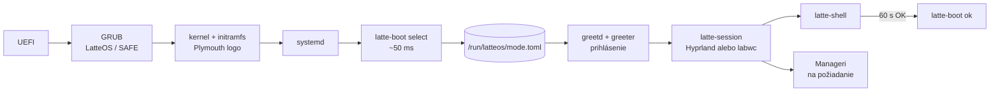
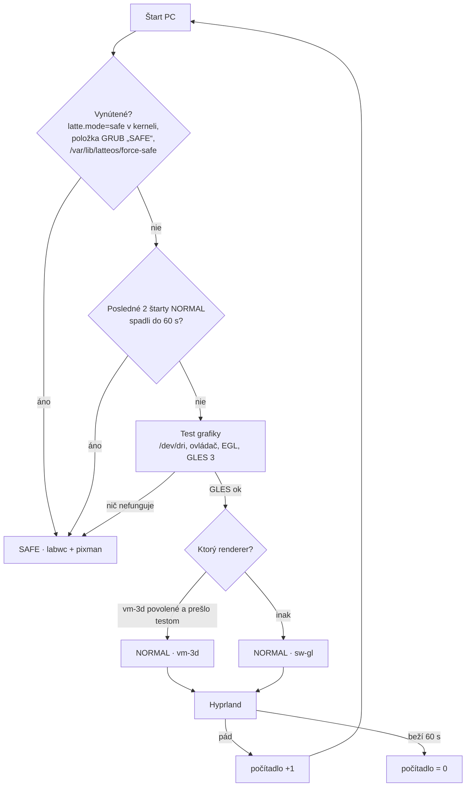

# Východiskový návrh: rámec, režimy a štart systému

Presunuté z ROADMAP.md (riadky 14–164) 9. 10. 2026; text je pôvodný z 23. 9.–8. 10. 2026. Čo sa týka Classicu, je to história;
platná architektúra je v [ARCHITECTURE.md](ARCHITECTURE.md).

## Rámec

| | Teraz (fázy F0–F8) | Neskôr |
|---|---|---|
| Systém | **Fedora Server 44**, klasický (dnf) | Fedora Atomic (bootc / rpm-ostree), štýl Bazzite, **až keď bude všetko hotové** |
| Stroj | **VirtualBox VM** `latteOSdev`: VMSVGA, 128 MB VRAM, 3D zapnuté, 4 vCPU, 11 GB RAM | reálny PC s 3D grafikou **AMD aj NVIDIA** |
| Grafika | **softvérová** (llvmpipe / pixman), VMSVGA 3D len ako doplnková možnosť | plná HW akcelerácia, Vulkan |

**Pravidlo pre všetko, čo vznikne teraz:** musí to bežať vo VM bez GPU. HW akcelerácia môže
iba pridať efekty, nikdy nesmie byť podmienkou fungovania.

## Odpoveď: pobeží stack bez akcelerácie?

Stav hosťa (overené na `latteOSdev`): adaptér `VMware SVGA II [15ad:0405]`, ovládač `vmwgfx`,
schopnosti `3D, dx, SM_5`. Kernel pritom hlási *„vmwgfx seems to be running on an unsupported
hypervisor. This configuration is likely broken.“* 3D cesta VirtualBoxu je preto menej spoľahlivá
ako vo VMware a nesmieme na nej stavať.

Vo VM prichádzajú do úvahy tri grafické cesty:

- **A · sw-gl:** GL cez llvmpipe na CPU. 3D je vypnuté alebo sa ignoruje (`MESA_LOADER_DRIVER_OVERRIDE=kms_swrast`, pozri F0).
- **B · vm-3d:** Mesa ovládač `svga` nad VMSVGA 3D.
- **C · pixman:** čisté CPU kreslenie, žiadne GL.

| Komponent | A · sw-gl | B · vm-3d | C · pixman | Poznámka |
|---|---|---|---|---|
| **Hyprland 0.56** | ✅ overené | ⚠️ overené: patch + render voľby, artefakty | ❌ | Vyžaduje GLES 3 cez EGL/GBM a pixman renderer nemá. llvmpipe GLES 3.2 poskytuje. Pod B bez patchu padajú GPU klienti (čierna plocha). |
| labwc (wlroots) | ✅ overené | ❌ overené bez patchu | ✅ overené `WLR_RENDERER=pixman` | Jediný kompozitor zo zoznamu, ktorý beží **úplne bez GL**, preto je základom SAFE. |
| Quickshell / DMS / Caelestia | ✅ pomalšie | ⚠️ | ⚠️ len `QT_QUICK_BACKEND=software` | `ShaderEffect` (materiály tém) na llvmpipe beží, na Qt software backende nie. |
| xdph, hyprlock, matugen, portály | ✅ | ✅ | ✅ | nenáročné |
| Mission Center, cosmic-files | ✅ | ✅ | ✅ | GTK4/iced majú softvérovú cestu |
| Ollama | ✅ CPU | — | — | vo VM len malý model 3–4B; Qwen3-14B-sk (Q4 ~9 GB) sa nezmestí popri desktope |
| Steam, umu, Proton | ⚠️ launcher áno, hry prakticky nie | ⚠️ | ❌ | DXVK/vkd3d potrebujú Vulkan; lavapipe je len na smoke test |
| gamescope | ❌ | ❌ | ❌ | potrebuje skutočný Vulkan + DRM → **fáza HW** |
| Valve Lepton | ❌ | ❌ | ❌ | mountuje Mesa/zink z hostiteľa, cieľ je Steam Frame → **fáza HW** |

✅ = funguje, ⚠️ = s obmedzením, ❌ = nefunguje. Stĺpce „očakávané“ vychádzajú z dokumentácie a
hlásení používateľov. **Prvá úloha F1 je overiť celú tabuľku meraním na `latteOSdev`.**

**Záver:** Hyprland aj navrhované nástroje môžu bežať bez akcelerácie (cesta A). Na VMSVGA 3D
(cesta B) pobežia iba s patchom `vmwgfx-dmabuf`. Predvolená cesta vo VM bude A. Cestu B zapne
selektor iba vtedy, keď prejde test. SAFE režim stojí na ceste C.

## Režimy: NORMAL a SAFE

| | **NORMAL** | **SAFE** |
|---|---|---|
| Kompozitor | Hyprland (+ vmwgfx patch) + Lua modul LatteOS | labwc (balík Fedory) |
| Renderer | GLES: vm-3d → sw-gl podľa testu | **pixman** (nulová závislosť na GL/EGL/GPU) |
| Shell | plný LatteOS shell (Quickshell) | minimálny: foot + fuzzel + `latte-safe` ponuka; žiadne shadery, žiadna priehľadnosť |
| Efekty | podľa stupňa výkonu (vo VM tier **Softvér** = téma Úsporná) | žiadne |
| Účel | bežná práca | štart pri akomkoľvek probléme: rozbitý GPU stack, pád shellu, zlý update, chýbajúci ovládač |
| Ponuka `latte-safe` | — | diagnostika (log posledného pádu), „skúsiť NORMAL znova“, „vrátiť posledný update“, terminál, sieť |

SAFE musí naštartovať aj s parametrom kernelu `nomodeset`: labwc + pixman beží nad `simpledrm`.
Je to posledná záchrana, ktorá funguje s hocijakou grafikou.

### Štart systému: od zapnutia po shell

Tvoja predstava (BIOS → kernel → latte start → prihlásenie → shell) je správna, poradie tiež.
Upresnenia:

- „Latte start“ **nie je samostatná obrazovka ani prostredie.** Je to jedna krátka systemd služba
  (~50 ms), ktorá beží medzi ostatnými službami, kým je na obrazovke boot logo.
- Režim sa musí rozhodnúť **pred** obrazovkou prihlásenia, pretože aj tá je grafická a potrebuje
  kompozitor.
- Pod ňou je ešte jedna poistka: **GRUB**. Ak zlyhá už kernel, žiadna naša služba sa nespustí.

| # | Fáza | Čo beží | LatteOS časť | Čas na `latteOSdev` |
|---|---|---|---|---|
| 1 | Zapnutie | UEFI firmvér (BIOS), POST | — | mimo Linuxu |
| 2 | Bootloader | **GRUB**: položky „LatteOS“ a „LatteOS SAFE“ (`latte.mode=safe`); ponuka je skrytá, ukáže sa po neúspešnom štarte (Fedora `boot_success` flag) | GRUB téma, položka SAFE | — |
| 3 | Kernel + initramfs | ovládače (vmwgfx, neskôr amdgpu/nvidia), disk | **Plymouth** boot logo Latte (zakryje text a čiernu obrazovku) | 2,1 s + 5,2 s |
| 4 | systemd | desiatky služieb **paralelne** | — | 7,2 s spolu |
| 5 | **Latte start** | `latte-boot.service` (oneshot, `Before=greetd.service`): `latte-boot select` | detekcia HW/SW, výber režimu → `/run/latteos/mode.toml` | ~0,05 s (namerané: `/sys` 0 ms, EGL test 40 ms) |
| 6 | **Session Manager** | greetd → greeter vo vlastnom malom kompozitore podľa režimu | obrazovka prihlásenia (kandidát: Noctalia Greeter) | — |
| 7 | Relácia | po prihlásení `latte-session` prečíta `mode.toml` → Hyprland (NORMAL) alebo labwc (SAFE) cez systemd user (`latte-session.target`) | Lua modul, SAFE konfigurácia | — |
| 8 | **Shell** | `latte-shell.service`: **jeden** proces s lištou, Text Barom, panelmi a notifikáciami | shell | — |
| 9 | Manageri | Rust služby spúšťané **až na požiadanie** (D-Bus aktivácia), nie všetky pri štarte | Device, Process, Data, App, Session | — |
| 10 | Potvrdenie | po 60 s zdravej relácie `latte-boot ok`: vynuluje počítadlo pádov, nastaví GRUB `boot_success` | — | — |

### Jeden program, alebo viac malých?

**Pravidlo:** delí sa podľa toho, **kedy, s akými právami a ako dlho** kód beží. Nedelí sa podľa
funkcií. Čo beží spolu, s rovnakými právami a zdieľa dáta, patrí do jedného programu. Čo má inú
životnosť, iné práva alebo môže spadnúť nezávisle, patrí do samostatného programu.

| Program | Kedy / práva | Prečo samostatne |
|---|---|---|
| **`latte-boot`** (Rust, 1 binárka) | pri štarte, root, pár ms | jedna binárka s modulmi (`gpu`, `display`, `input`, `cmdline`, `crash`) a príkazmi `probe`, `select`, `ok`. **Nie** viac malých detektorov: zbytočné spúšťanie procesov a zložité poradie pre 50 ms práce |
| greeter | pred prihlásením, vlastný používateľ `greeter` | bezpečnosť: nevidí dáta používateľa |
| `latte-session` | po prihlásení, používateľ | spúšťa a stráži kompozitor; musí prežiť jeho pád |
| kompozitor | používateľ | cudzí projekt (Hyprland/labwc) |
| **shell** (1 proces) | používateľ, celá relácia | princíp „jeden mozog“ z radaru: jeden proces pre všetky panely, spoločný stav a téma |
| Manageri (každý zvlášť) | na požiadanie, časti cez polkit s root právami | pád Process Managera nesmie zhodiť shell; rôzne práva |

Detekčný kód z `latte-boot` je **knižnica** (Rust crate `latte-hw`). Device Manager ju neskôr
použije na plnú inventúru HW. Pomalé testy (Vulkan 180 ms, benchmark stupňa výkonu) nepatria do
štartu. Spustí ich Device Manager po prihlásení a výsledok uloží pre ďalší štart.

### Výber režimu — `latte-boot select`

Výsledok zapíše do `/run/latteos/mode.toml`. Ten súbor je jediné miesto pravdy: číta ho greeter,
`latte-session`, Hyprland Lua modul aj shell.

- **Počítadlo pádov:** rovnaký princíp ako `systemd-bless-boot`. `latte-session` zvýši počítadlo pri
  štarte kompozitora a `latte-boot ok` ho vynuluje po 60 s. Pád teda zaznamená niekto mimo toho,
  čo padá.
- **Test grafiky** (`latte-boot probe`): PCI ID a ovládač z `/sys`, EGL/GBM (renderer `llvmpipe`
  vs. `SVGA3D`), GLES 3.x. Výstupom je `renderer = vm-3d | sw-gl | none` a `tier`. Vulkan a stupne
  výkonu (Plný…Minimálny, NVIDIA 580/595) doplní Device Manager po prihlásení.
- **Ručná voľba:** v GRUB-e sú vždy dve položky, „LatteOS“ a „LatteOS SAFE“. V greeteri je voľba
  relácie (NORMAL/SAFE) pre toto prihlásenie.
- **Návrat:** zo SAFE ide jedným klikom „skúsiť NORMAL“ (vynuluje počítadlo). V NORMAL sa dá zapnúť
  „nabudúce SAFE“.

**Audit podľa Windows 11 a prieskum rozhrania (29. 9.):** [audit](docs_zaloha/2026-09-29-audit-win11.md) — myš ako hlavný ovládač,
stav LatteOS aj Noctalie, novinky, rice, moduly skla, návrh rozhrania a poradie krokov. Rozhodnuté: cesta 2
(vlastné prostredie Hyprland + Noctalia nad ublue `base-main` + `akmods`, všetko pripnuté).

